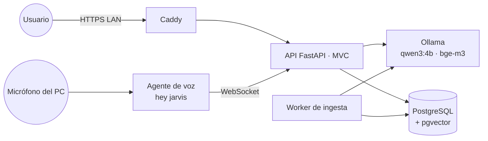

# JARVIS v1.0 · Asistente personal con IA 100 % local

> Un asistente al estilo JARVIS que conversa por **texto y voz**, responde con **fuentes verificables** y **aprende de sus dueños**.
> Corre por completo en un PC de la casa, sin APIs de terceros y sin enviar datos a la nube.

> 🚧 **Proyecto en construcción.** Se desarrolla por etapas y cada una queda documentada en `docs/`.

**Estado:** 🟡 Etapa 0: fundaciones y arquitectura

---

## Principios

1. **Privacidad primero.** Las conversaciones, los documentos y la voz nunca salen del PC.
2. **Responder con fuentes.** El conocimiento vive en una base vectorial local (RAG). JARVIS cita de dónde sale cada respuesta.
3. **Aprender sin filtrar datos.** Los datos personales se usan sólo en local. El ajuste fino en la nube se hace únicamente con datos públicos.
4. **Funcionar en hardware modesto.** Está diseñado para un portátil con GPU de 4 GB y 8 GB de RAM.
5. **Construirlo entendiendo cada pieza.** Hay una etapa por tecnología, cada una documentada.

## Stack

| Capa | Tecnología |
|---|---|
| Modelo de lenguaje | [Ollama](https://ollama.com) + `qwen3:4b` |
| Embeddings | `bge-m3` (multilingüe, 1024 dimensiones) |
| Base de datos | PostgreSQL 17 + [pgvector](https://github.com/pgvector/pgvector) (Docker) |
| Backend (MVC) | Python 3.12 · FastAPI · SQLAlchemy 2 · Alembic |
| Vista | Jinja2 · HTMX · WebSocket |
| Voz a texto | [faster-whisper](https://github.com/SYSTRAN/faster-whisper) + Silero VAD |
| Texto a voz | [Piper](https://github.com/OHF-Voice/piper1-gpl) |
| Palabra de activación | [openWakeWord](https://github.com/dscripka/openWakeWord) ("hey jarvis") |
| Ajuste fino | [Unsloth](https://github.com/unslothai/unsloth) (QLoRA) → GGUF → Ollama |
| HTTPS en la red local | [Caddy](https://caddyserver.com) |

## Arquitectura



| Documento | Contenido |
|---|---|
| [C4 · Contexto](docs/arquitectura/01-c4-contexto.md) | Quién usa JARVIS y con qué se relaciona |
| [C4 · Contenedores](docs/arquitectura/02-c4-contenedores.md) | Procesos, puertos y comunicación |
| [C4 · Componentes](docs/arquitectura/03-c4-componentes.md) | Estructura MVC de la API y flujo de una pregunta por voz |
| [Diagrama de clases](docs/arquitectura/04-diagrama-de-clases.md) | Modelo de dominio y capa de aplicación |
| [Modelo relacional](docs/arquitectura/05-modelo-relacional.md) | Diagrama ER y SQL de la base de datos |

## Documentación del proyecto

| # | Documento |
|---|---|
| 01 | [Requisitos de hardware y memoria](docs/01-requisitos-de-hardware.md) |
| 02 | [Acceso desde otros dispositivos de la casa](docs/02-acceso-desde-la-red-local.md) |
| 03 | [Etapas del proyecto y entregables](docs/03-etapas-del-proyecto.md) |
| 04 | [Instalación paso a paso](docs/04-instalacion-paso-a-paso.md) |

## Hoja de ruta

| Etapa | Tecnología | Estado |
|---|---|---|
| 0 | Fundaciones: Git, documentación y arquitectura | 🟡 En curso |
| 1 | Backend MVC con FastAPI | ⚪ |
| 2 | PostgreSQL + pgvector | ⚪ |
| 3 | Ollama: modelo de lenguaje local | ⚪ |
| 4 | Vista web | ⚪ |
| 5 | Embeddings y RAG | ⚪ |
| 6 | Ingesta de conocimiento externo | ⚪ |
| 7 | Voz a texto (faster-whisper) | ⚪ |
| 8 | Texto a voz (Piper) | ⚪ |
| 9 | Palabra de activación "Hey JARVIS" | ⚪ |
| 10 | Seguridad y acceso en la red local | ⚪ |
| 11 | Memoria y datos personales | ⚪ |
| 12 | Fine-tuning con LoRA | ⚪ |
| 13 | Herramientas y versión 1.0 | ⚪ |

## Estructura del repositorio (objetivo)

```
JARVIS v1.0/
├── app/
│   ├── models/          # M · entidades SQLAlchemy
│   ├── repositories/    # M · acceso a datos
│   ├── views/           # V · plantillas Jinja2 y archivos estáticos
│   ├── schemas/         # V · contratos JSON (Pydantic)
│   ├── controllers/     # C · routers FastAPI
│   ├── services/        # lógica de negocio (chat, RAG, voz, entrenamiento)
│   ├── core/            # configuración, BD, seguridad, logging
│   └── main.py
├── worker/              # worker de ingesta
├── agents/voice/        # agente de palabra de activación
├── training/            # notebooks y scripts de LoRA
├── migrations/          # Alembic
├── tests/
├── docs/                # documentación y bitácoras por etapa
├── data/                # (ignorado por Git) corpus, audios, copias
└── models/              # (ignorado por Git) archivos GGUF
```

## Hardware de referencia

Intel Core i5‑10300H · NVIDIA GTX 1650 Ti 4 GB · 8 GB RAM · 250 GB de disco · Windows 11.
