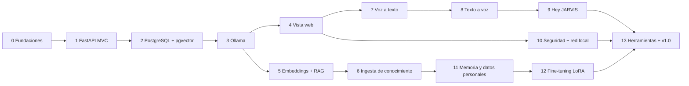

# 03 · Etapas del proyecto

El proyecto se divide en **14 etapas**, casi todas dedicadas a **una sola tecnología**. Así cada proceso se entiende por separado antes de combinarlo con los demás.

Cada etapa tiene:
- **Objetivo**: qué problema resuelve.
- **Tecnología**: lo único nuevo que se aprende.
- **Entregables parciales**: lo que queda en el repo al terminar.
- **Criterio de terminado**: cómo se comprueba que funciona.
- **Rama Git**: `etapa/NN-nombre`. Se fusiona a `main` y se marca con la etiqueta `etapa-NN`.

Al cerrar cada etapa también se escribe su bitácora en `docs/etapas/NN-nombre.md`: qué se hizo, por qué, problemas encontrados y capturas.



---

## Etapa 0 · Fundaciones del proyecto
**Tecnología:** Git + GitHub + documentación (Markdown y Mermaid).
**Objetivo:** tener el repo, la arquitectura y las reglas de trabajo definidas antes de escribir código.

**Entregables**
- [x] Repo Git inicializado con `.gitignore` que protege modelos, datos y secretos.
- [x] `README.md` con visión, stack y hoja de ruta.
- [x] Requisitos de hardware, acceso en red, etapas y guía de instalación.
- [x] Diagramas C4 (contexto, contenedores, componentes), diagrama de clases y modelo relacional.
- [x] Repo publicado en GitHub.

**Terminado cuando:** el repo está en GitHub y los diagramas se ven bien en la web.

---

## Etapa 1 · Backend MVC con FastAPI
**Tecnología:** Python 3.12 + FastAPI + Pydantic + pytest.
**Objetivo:** el esqueleto de la aplicación con la estructura MVC definitiva.

**Entregables** · ✅ [bitácora](etapas/01-fastapi-mvc.md)
- [x] Estructura `app/models`, `app/views`, `app/controllers`, `app/services`, `app/repositories`, `app/schemas`, `app/core`.
- [x] Configuración con `pydantic-settings` y archivo `.env.example`.
- [x] Endpoint `GET /health` y registro de eventos (logging) en formato estructurado.
- [x] Primeras pruebas con `pytest` y verificación de estilo con `ruff`.
- [x] `pyproject.toml` con las dependencias.

**Terminado cuando:** `uvicorn app.main:app` arranca, `/health` responde `{"status":"ok"}` y `pytest` pasa.

---

## Etapa 2 · Base de datos: PostgreSQL + pgvector
**Tecnología:** Docker Compose + PostgreSQL 17 + pgvector + SQLAlchemy 2 + Alembic.
**Objetivo:** guardar conversaciones, documentos y vectores.

**Entregables** · ✅ [bitácora](etapas/02-postgres-pgvector.md)
- [x] `docker-compose.yml` con la imagen `pgvector/pgvector:pg17`, un volumen persistente y límites de memoria.
- [x] Modelos SQLAlchemy de [el modelo relacional](arquitectura/05-modelo-relacional.md).
- [x] Primera migración de Alembic (tablas, índice HNSW y búsqueda de texto completo).
- [x] Repositorios base (`BaseRepository`) y datos de prueba (*seed*).
- [x] Script de copia de seguridad (`pg_dump`).

**Terminado cuando:** `alembic upgrade head` crea todo, y una prueba inserta un vector y lo recupera por similitud.

---

## Etapa 3 · Modelo de lenguaje local con Ollama
**Tecnología:** Ollama (API HTTP) + `qwen3:4b-instruct`.
**Objetivo:** que JARVIS converse, con personalidad propia.

**Entregables**
- `LLMProvider` (interfaz) y `OllamaProvider` (implementación), con respuestas en streaming.
- `Modelfile` de JARVIS: indicaciones de sistema, temperatura y tamaño de contexto.
- `ChatService` que guarda conversación y mensajes en la base de datos.
- Endpoint `POST /api/chat` con streaming.
- Comparación documentada entre `qwen3:4b-instruct`, `qwen3:4b` (con razonamiento), `gemma3:4b` y `llama3.2:3b` (calidad en español, velocidad, VRAM).

**Terminado cuando:** desde Swagger (`/docs`) se conversa con JARVIS y el historial queda en PostgreSQL.

---

## Etapa 4 · Vista web (la "V" de MVC)
**Tecnología:** Jinja2 + HTMX + WebSocket + CSS propio.
**Objetivo:** una interfaz para conversar desde el navegador.

**Entregables**
- Plantillas: `base.html`, `chat.html` y la lista de conversaciones.
- Respuestas que aparecen palabra por palabra (WebSocket).
- Diseño adaptable a celular, con tema claro y oscuro.

**Terminado cuando:** se conversa desde el navegador del PC y se ve bien en pantalla de celular.

---

## Etapa 5 · Embeddings y RAG (búsqueda aumentada)
**Tecnología:** `bge-m3` en Ollama + pgvector (HNSW) + búsqueda de texto completo de PostgreSQL.
**Objetivo:** que JARVIS responda con datos verificables y cite sus fuentes.

**Entregables**
- `EmbeddingService` (`bge-m3`, 1024 dimensiones, en CPU).
- `Chunker`: fragmentos de unos 500 tokens con solapamiento.
- `RetrievalService`: búsqueda **híbrida** (vectorial + palabras clave) combinada con *Reciprocal Rank Fusion*.
- `PromptBuilder` que inyecta el contexto y pide citas.
- Tabla `message_sources` para mostrar de dónde salió cada respuesta.
- **Conjunto de evaluación**: 50 preguntas con respuesta conocida para medir la precisión.
- *Opcional (con 16 GB de RAM):* reranker `bge-reranker-v2-m3`.

**Terminado cuando:** con algunos documentos de prueba cargados, JARVIS responde citando la fuente correcta en al menos el 80 % del conjunto de evaluación.

---

## Etapa 6 · Ingesta de conocimiento externo
**Tecnología:** `trafilatura` (extracción web) + `pypdf`/`python-docx` + dumps de Wikipedia + worker en segundo plano.
**Objetivo:** cargar todo el conocimiento externo **durante el desarrollo**, para luego trabajar sin conexión.

**Entregables**
- `DocumentLoader` (interfaz) con `FileLoader`, `WebLoader` (respeta `robots.txt`) y `WikipediaLoader`.
- `IngestionWorker`: proceso aparte que toma tareas de `ingestion_jobs`.
- Eliminación de duplicados por `content_hash`.
- Panel "Conocimiento": fuentes, progreso y errores.
- Primer corpus: temas seleccionados de Wikipedia en español y la documentación técnica que elijas.

**Terminado cuando:** un corpus de al menos 50 000 artículos queda indexado, y JARVIS responde sobre él **con internet desconectado**.

---

## Etapa 7 · Voz a texto (STT)
**Tecnología:** `faster-whisper` (modelo `small`, CPU int8) + Silero VAD.
**Objetivo:** que JARVIS entienda lo que le dices.

**Entregables**
- `STTService` con la interfaz `SpeechToText`.
- Botón "mantener para hablar" en la vista web (grabación con `MediaRecorder`).
- Endpoint WebSocket `/ws/voice` que recibe el audio y devuelve el texto.
- Medición de la precisión en español y del tiempo de respuesta.

**Terminado cuando:** dices una frase y aparece transcrita en menos de 2 segundos.

---

## Etapa 8 · Texto a voz (TTS)
**Tecnología:** Piper (voz `es_MX-ald-medium` o `es_ES-davefx-medium`).
**Objetivo:** que JARVIS responda hablando.

**Entregables**
- `TTSService` con la interfaz `TextToSpeech`.
- Síntesis **por frases**: empieza a hablar mientras el modelo sigue escribiendo.
- Selector de voz y de velocidad en la vista.

**Terminado cuando:** el ciclo completo "hablas → piensa → responde con voz" toma menos de 4 segundos hasta la primera palabra.

---

## Etapa 9 · Palabra de activación "Hey JARVIS"
**Tecnología:** openWakeWord (modelo `hey_jarvis`) + `sounddevice`.
**Objetivo:** activar JARVIS sin tocar nada, con el micrófono del PC servidor.

**Entregables**
- `VoiceAgent`: proceso aparte que escucha continuamente, detecta "hey jarvis", graba hasta el silencio y envía el audio a la API.
- Sonido de confirmación al activarse y salida por los parlantes del PC.
- Ajuste del umbral para evitar activaciones falsas.

**Terminado cuando:** dices "Hey JARVIS, ¿qué hora es?" desde 2 metros y responde por los parlantes.

---

## Etapa 10 · Seguridad y acceso desde la red local
**Tecnología:** Caddy (HTTPS local) + Argon2 + sesiones con JWT + Firewall de Windows.
**Objetivo:** entrar desde el celular y otros dispositivos de forma segura. Ver [acceso en red](02-acceso-desde-la-red-local.md).

**Entregables**
- `AuthService`, login y los roles `owner`, `member` y `guest`.
- `Caddyfile` con `tls internal` y una guía para instalar el certificado en el celular.
- Regla de firewall sólo para la red privada y reserva de IP en el router.
- Pruebas: un `guest` no puede ver los documentos personales.

**Terminado cuando:** desde el celular entras con usuario y contraseña a `https://<ip-del-pc>` y le hablas a JARVIS por el micrófono del celular.

---

## Etapa 11 · Memoria y datos personales (módulo de entrenamiento, parte 1)
**Tecnología:** pgvector (memoria a largo plazo) + calificación de respuestas.
**Objetivo:** que JARVIS aprenda de **ti** sin que tus datos salgan del PC.

**Entregables**
- Panel "Entrenamiento": subir documentos personales (PDF, Word, notas). Quedan marcados `is_personal`.
- `MemoryService`: JARVIS guarda datos importantes que le cuentas ("mi cumpleaños es…") y los recuerda en conversaciones futuras.
- Botones 👍 / 👎 en cada respuesta, con un campo para escribir la respuesta correcta.
- Las correcciones se convierten en ejemplos de entrenamiento (`training_examples`).

**Terminado cuando:** le cuentas algo, cierras la conversación, abres otra, y lo recuerda.

---

## Etapa 12 · Fine-tuning con LoRA (módulo de entrenamiento, parte 2)
**Tecnología:** Unsloth (QLoRA) + Google Colab o Kaggle (GPU gratis) + exportación a GGUF + `ollama create`.
**Objetivo:** ajustar el estilo y la personalidad de JARVIS. **El conocimiento ya vive en el RAG.**

**Regla de privacidad:**
| Dataset | Dónde se entrena |
|---|---|
| Sólo datos públicos o sintéticos (personalidad, formato, español) | Colab o Kaggle (nube gratuita) |
| Contiene datos personales (`contains_personal_data = true`) | **Sólo en local**: modelo de 1B a 3B, más lento pero privado |

**Entregables**
- Notebook `training/notebooks/jarvis_lora.ipynb` listo para Colab.
- Script de exportación del dataset a JSONL desde la BD.
- Conversión a GGUF Q4_K_M y `Modelfile` con el adaptador.
- `ModelManager`: registra la versión en `model_versions` y permite activarla o volver a la anterior.
- Comparación modelo base contra modelo ajustado, usando el conjunto de evaluación de la Etapa 5.

**Terminado cuando:** existe `jarvis:v1` en Ollama, supera al modelo base en el estilo de respuesta y no empeora la precisión.

---

## Etapa 13 · Herramientas, evaluación final y versión 1.0
**Tecnología:** *tool calling* de Ollama + pruebas de extremo a extremo.
**Objetivo:** que JARVIS haga cosas y no sólo responda.

**Entregables**
- Herramientas locales: hora y fecha, recordatorios, búsqueda en tus archivos y estado del sistema (CPU, GPU, disco).
- Copias de seguridad automáticas de la BD.
- README final con capturas, video corto de demostración y diagramas actualizados.
- Etiqueta `v1.0.0` y *release* en GitHub.

**Terminado cuando:** todas las pruebas pasan y JARVIS funciona completo **sin conexión a internet**.

---

## Flujo de trabajo con Git

```
main ──●─────────────●─────────────●──── (etapa-00, etapa-01, …)
        \           /  \           /
         ●──●──●──●     ●──●──●──●
       etapa/01-fastapi-mvc   etapa/02-postgres-pgvector
```

1. `git switch -c etapa/NN-nombre`
2. Commits pequeños con el formato *Conventional Commits*: `feat:`, `fix:`, `docs:`, `test:`, `refactor:`, `chore:`.
3. Al terminar: Pull Request a `main` con la lista de entregables marcada.
4. Fusión, etiqueta `etapa-NN` y bitácora en `docs/etapas/`.
