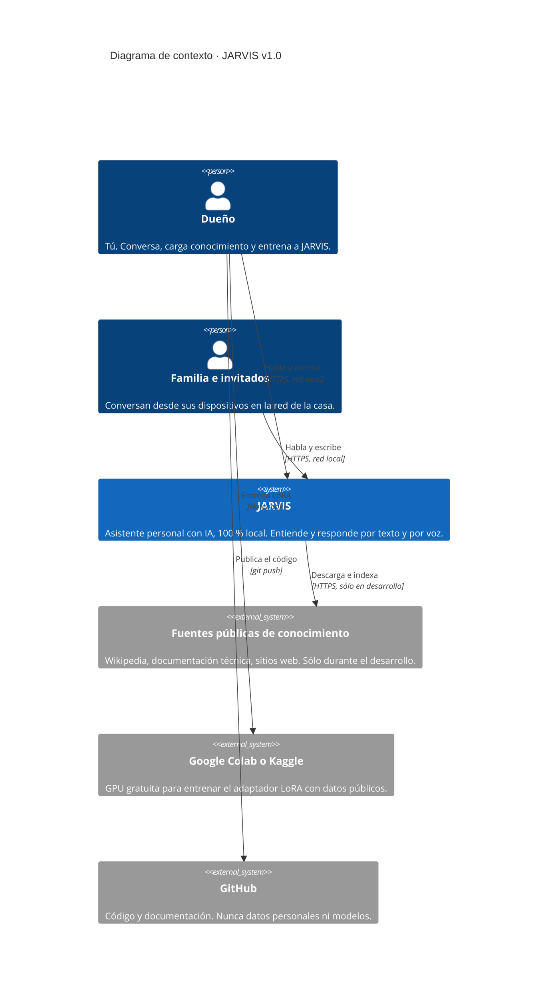

# C4 · Nivel 1: Contexto

**Pregunta que responde:** ¿quién usa JARVIS y con qué sistemas externos se relaciona?

El modelo C4 describe un sistema en 4 niveles de zoom: **Contexto → Contenedores → Componentes → Código**.
Éste es el nivel más alejado: JARVIS se ve como una sola caja.

## Elementos

| Elemento | Tipo | Descripción |
|---|---|---|
| Dueño | Persona | Rol `owner`. Único que puede cargar conocimiento, entrenar y administrar modelos y usuarios. |
| Familia e invitados | Persona | Roles `member` y `guest`. Conversan, sin acceso a los datos personales del dueño. |
| **JARVIS** | Sistema | Todo lo que corre en el PC servidor: app web, API, modelos, base de datos y voz. |
| Fuentes públicas | Sistema externo | Sólo se consultan **durante el desarrollo**, para construir la base de conocimiento. Luego se puede desconectar. |
| Colab o Kaggle | Sistema externo | Entrena con **datos públicos**. Los datos personales nunca se suben. |
| GitHub | Sistema externo | Escaparate del proyecto. El `.gitignore` impide subir datos, modelos y secretos. |

## Límites de privacidad

- Ninguna conversación sale del PC.
- No hay APIs de terceros para el modelo de lenguaje, la voz ni los embeddings.
- La única conexión saliente de JARVIS (descargar fuentes públicas) se puede desactivar con `INGESTION_ALLOW_INTERNET=false`.
