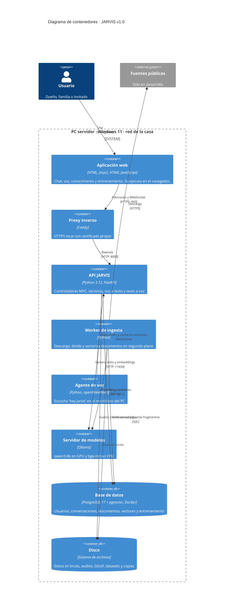

# C4 · Nivel 2: Contenedores

**Pregunta que responde:** ¿qué programas o procesos forman JARVIS y cómo se comunican?

En C4, un *contenedor* es algo que se ejecuta por separado o guarda datos: una app, un servidor, una base de datos. No confundir con un contenedor de Docker.

## Contenedores

| Contenedor | Tecnología | Puerto | Responsabilidad | Etapa |
|---|---|---|---|---|
| Aplicación web | Jinja2 + HTMX + JS | — | Interfaz. Graba el micrófono y reproduce audio. | 4, 7, 8 |
| Proxy inverso | Caddy | 443 | HTTPS en la LAN, necesario para usar el micrófono desde el celular | 10 |
| API JARVIS | FastAPI + Uvicorn | 8000 | Núcleo MVC: controladores, servicios y repositorios | 1 – 13 |
| Worker de ingesta | Python (proceso aparte) | — | Tareas largas sin bloquear el chat | 6 |
| Agente de voz | Python + openWakeWord + sounddevice | — | Modo manos libres en el PC | 9 |
| Servidor de modelos | Ollama | 11434 (sólo `127.0.0.1`) | Inferencia del modelo de chat y embeddings | 3, 5 |
| Base de datos | PostgreSQL 17 + pgvector | 5432 (sólo `127.0.0.1`) | Datos relacionales y vectoriales | 2 |
| Disco | Carpetas `data/` y `models/` | — | Archivos grandes que no van en la BD ni en Git | 2 – 12 |

## Decisiones

- **Ollama y PostgreSQL escuchan sólo en `127.0.0.1`.** Otros dispositivos de la casa no pueden acceder a ellos directamente, sólo a través de la API, que exige inicio de sesión.
- **El worker es un proceso aparte** para que indexar miles de documentos no frene las respuestas.
- **Sin Redis ni broker de mensajes**: la cola es la tabla `ingestion_jobs` (`SELECT … FOR UPDATE SKIP LOCKED`). Ahorra RAM.
- **STT y TTS viven dentro de la API** y no en contenedores aparte: con 8 GB de RAM conviene cargar los modelos una sola vez.
