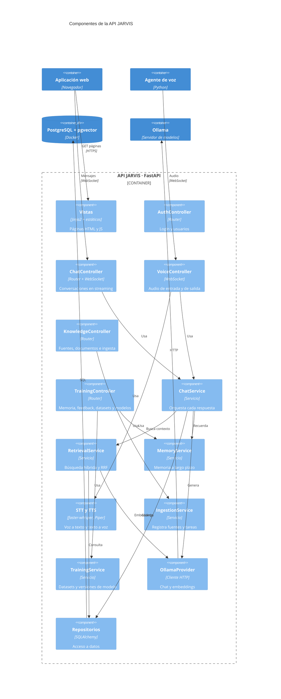
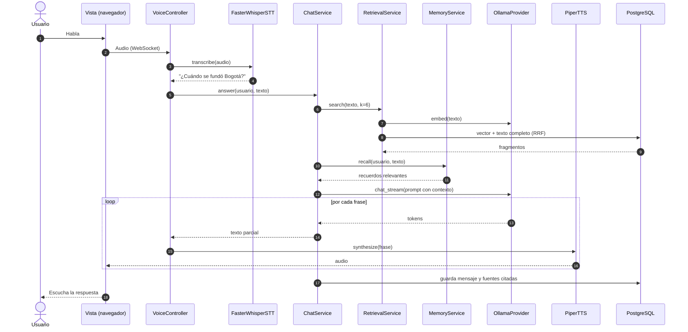

# C4 · Nivel 3: Componentes de la API

**Pregunta que responde:** ¿cómo está organizada por dentro la API JARVIS, el contenedor principal?

La API sigue **MVC**, con dos capas de apoyo que mantienen los controladores delgados:

| Capa MVC | Carpeta | Qué contiene |
|---|---|---|
| **Modelo** | `app/models/`, `app/repositories/` | Entidades SQLAlchemy y el acceso a datos |
| **Vista** | `app/views/` (plantillas y estáticos), `app/schemas/` (JSON) | Lo que ve el usuario: HTML o respuestas JSON |
| **Controlador** | `app/controllers/` | Routers de FastAPI: reciben la petición, validan, llaman servicios y devuelven la vista |
| *Servicios* | `app/services/` | Lógica de negocio: RAG, chat, voz, entrenamiento |
| *Núcleo* | `app/core/` | Configuración, conexión a la BD, seguridad y registros |

## Flujo de una pregunta por voz

## Componentes

| Componente | Responsabilidad | Depende de |
|---|---|---|
| `AuthController` | Login, logout, gestión de usuarios (sólo `owner`) | `AuthService` |
| `ChatController` | Crear y listar conversaciones; WebSocket de chat | `ChatService` |
| `VoiceController` | WebSocket de audio: recibe voz y devuelve texto + audio | `STTService`, `ChatService`, `TTSService` |
| `KnowledgeController` | CRUD de fuentes y documentos; lanzar ingesta | `IngestionService` |
| `TrainingController` | Feedback, memoria, datasets, trabajos de entrenamiento, activar modelos | `TrainingService`, `MemoryService` |
| `ChatService` | Arma el prompt (sistema + memoria + contexto RAG + historial) y guarda el resultado | `RetrievalService`, `MemoryService`, `LLMProvider`, repos |
| `RetrievalService` | Búsqueda vectorial y de texto completo, fusionadas con RRF; filtra los documentos personales por dueño | `EmbeddingService`, `ChunkRepository` |
| `MemoryService` | Extrae y guarda datos sobre el usuario; los recupera por similitud | `EmbeddingService`, `MemoryRepository` |
| `IngestionService` | Registra fuentes, crea tareas; el worker ejecuta `process(job)` | Loaders, `Chunker`, `EmbeddingService` |
| `TrainingService` | Convierte el feedback en ejemplos, exporta JSONL y registra modelos GGUF en Ollama | `ModelManager`, repos |
| `OllamaProvider` | Única puerta hacia Ollama: `chat_stream`, `embed`, `create_model` | Ollama HTTP |
