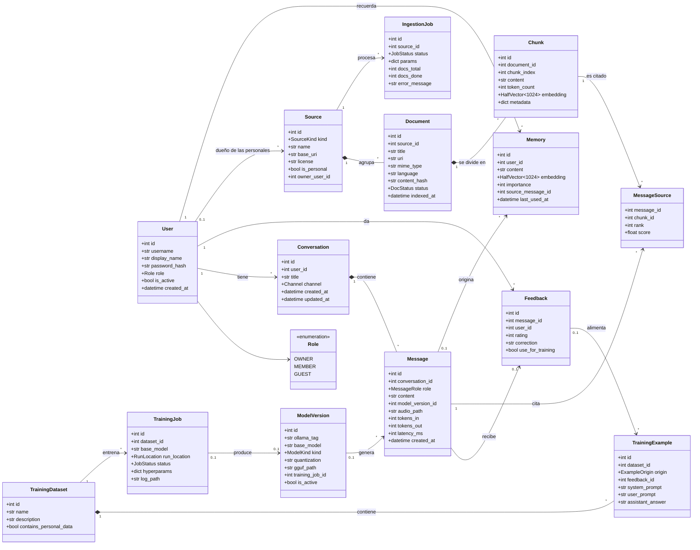

# Diagrama de clases

Son dos diagramas:
1. **Modelo de dominio**: las entidades que se guardan en la base de datos (la "M" de MVC).
2. **Capa de aplicación**: controladores, servicios, repositorios e interfaces.

Las interfaces (`<<interface>>`) permiten cambiar una tecnología sin tocar el resto. Por ejemplo, se podría cambiar Piper por XTTS implementando otro `TextToSpeech`.

## 1. Modelo de dominio

## 2. Capa de aplicación (controladores, servicios y repositorios)

```mermaid
classDiagram
  direction TB

  %% ---------- Controladores (C) ----------
  class ChatController {
    +list_conversations(user) list~ConversationOut~
    +create_conversation(user) ConversationOut
    +ws_chat(websocket, user)
  }
  class VoiceController {
    +ws_voice(websocket, user)
  }
  class KnowledgeController {
    +list_sources() list~SourceOut~
    +upload_document(file, user) DocumentOut
    +start_ingestion(source_id) JobOut
  }
  class TrainingController {
    +rate_message(message_id, FeedbackIn)
    +list_memories(user)
    +export_dataset(dataset_id) FileResponse
    +activate_model(model_version_id)
  }
  class AuthController {
    +login(LoginIn) TokenOut
    +logout()
    +create_user(UserIn) UserOut
  }

  %% ---------- Servicios ----------
  class ChatService {
    +answer(user, conversation_id, text) AsyncIterator~str~
  }
  class PromptBuilder {
    +build(system, memories, chunks, history, question) list~ChatMessage~
  }
  class RetrievalService {
    +search(query, user, k) list~ScoredChunk~
    -vector_search(embedding, k)
    -text_search(query, k)
    -rrf(lists) list~ScoredChunk~
  }
  class MemoryService {
    +recall(user, query, k) list~Memory~
    +remember(user, content, message_id)
  }
  class EmbeddingService {
    +embed(texts) list~list~float~~
  }
  class IngestionService {
    +register_source(SourceIn) Source
    +enqueue(source_id, params) IngestionJob
    +process(job)
  }
  class Chunker {
    +split(text, size, overlap) list~str~
  }
  class TrainingService {
    +examples_from_feedback(dataset_id) int
    +export_jsonl(dataset_id) Path
    +register_model(gguf_path, base_model) ModelVersion
  }
  class ModelManager {
    +create_from_gguf(tag, gguf_path, modelfile)
    +set_active(model_version)
  }
  class AuthService {
    +authenticate(username, password) User
    +hash_password(password) str
    +issue_token(user) str
  }

  %% ---------- Interfaces ----------
  class LLMProvider {
    <<interface>>
    +chat_stream(messages, options) AsyncIterator~str~
    +embed(texts, options) list~list~float~~
  }
  class SpeechToText {
    <<interface>>
    +transcribe(audio, language) str
  }
  class TextToSpeech {
    <<interface>>
    +synthesize(text, voice) bytes
  }
  class DocumentLoader {
    <<interface>>
    +load(params) Iterator~RawDocument~
  }

  %% ---------- Implementaciones ----------
  class OllamaProvider
  class FasterWhisperSTT
  class PiperTTS
  class FileLoader
  class WebLoader
  class WikipediaLoader

  %% ---------- Repositorios (M) ----------
  class BaseRepository~T~ {
    +get(id) T
    +add(entity) T
    +list(filters) list~T~
    +delete(id)
  }
  class ConversationRepository
  class ChunkRepository {
    +nearest(embedding, k, owner_id) list~ScoredChunk~
    +full_text(query, k, owner_id) list~ScoredChunk~
  }
  class MemoryRepository
  class JobRepository {
    +claim_next() IngestionJob
  }

  %% ---------- Procesos aparte ----------
  class IngestionWorker {
    +run_forever()
  }
  class VoiceAgent {
    +listen()
    -on_wake_word()
  }

  ChatController --> ChatService
  VoiceController --> SpeechToText
  VoiceController --> ChatService
  VoiceController --> TextToSpeech
  KnowledgeController --> IngestionService
  TrainingController --> TrainingService
  TrainingController --> MemoryService
  AuthController --> AuthService

  ChatService --> PromptBuilder
  ChatService --> RetrievalService
  ChatService --> MemoryService
  ChatService --> LLMProvider
  ChatService --> ConversationRepository
  RetrievalService --> EmbeddingService
  RetrievalService --> ChunkRepository
  MemoryService --> EmbeddingService
  MemoryService --> MemoryRepository
  EmbeddingService --> LLMProvider
  IngestionService --> DocumentLoader
  IngestionService --> Chunker
  IngestionService --> EmbeddingService
  IngestionService --> JobRepository
  TrainingService --> ModelManager
  ModelManager --> LLMProvider

  LLMProvider <|.. OllamaProvider
  SpeechToText <|.. FasterWhisperSTT
  TextToSpeech <|.. PiperTTS
  DocumentLoader <|.. FileLoader
  DocumentLoader <|.. WebLoader
  DocumentLoader <|.. WikipediaLoader

  BaseRepository <|-- ConversationRepository
  BaseRepository <|-- ChunkRepository
  BaseRepository <|-- MemoryRepository
  BaseRepository <|-- JobRepository

  IngestionWorker --> IngestionService
  VoiceAgent ..> VoiceController : WebSocket
```

## Cómo leerlo

| Símbolo | Significado |
|---|---|
| `A --> B` | A usa a B |
| `A *-- B` | Composición: si se borra A, se borran sus B (por ejemplo, la conversación y sus mensajes) |
| `A <\|.. B` | B implementa la interfaz A |
| `A <\|-- B` | B hereda de A |
| `A ..> B` | Dependencia externa, por la red |
