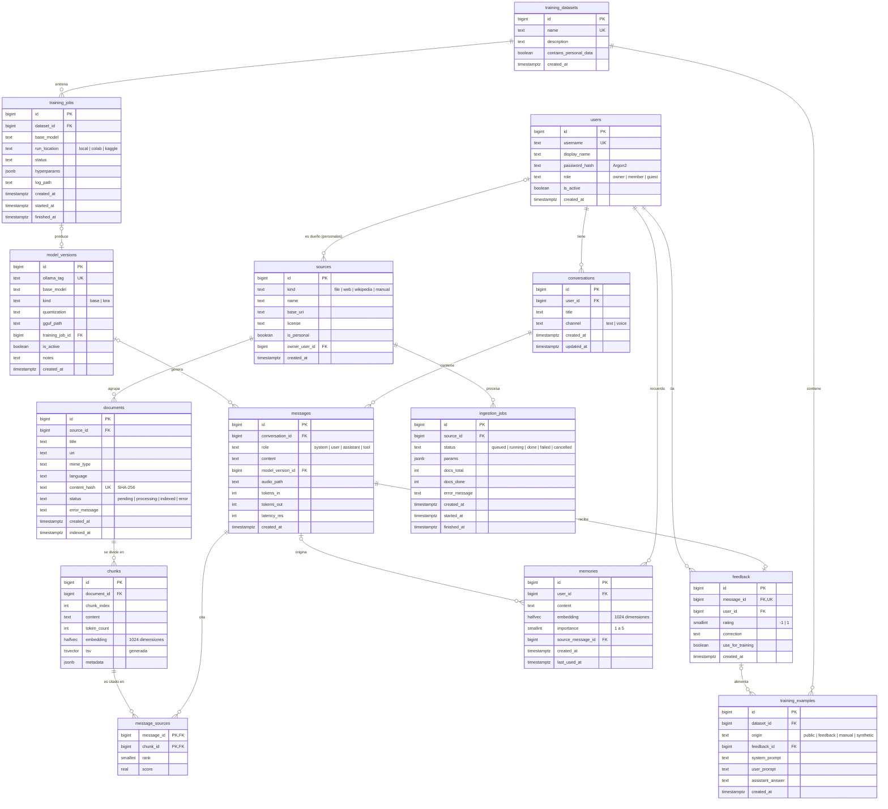

# Modelo relacional de la base de datos

Motor: **PostgreSQL 17** con la extensión **pgvector**.
La base guarda tres grupos de datos:

| Grupo | Tablas | Para qué |
|---|---|---|
| Conversación | `users`, `conversations`, `messages`, `message_sources`, `feedback`, `memories` | Lo que hablas con JARVIS y lo que recuerda de ti |
| Conocimiento | `sources`, `documents`, `chunks`, `ingestion_jobs` | Todo lo que sabe, vectorizado para búsqueda |
| Entrenamiento | `training_datasets`, `training_examples`, `training_jobs`, `model_versions` | El módulo para seguir entrenándolo |

## Diagrama entidad-relación



## Script SQL (referencia)

En la Etapa 2 este esquema se crea con **migraciones de Alembic**. El SQL queda aquí como referencia legible.

```sql
CREATE EXTENSION IF NOT EXISTS vector;

-- ===================== Conversación =====================
CREATE TABLE users (
  id            bigint GENERATED ALWAYS AS IDENTITY PRIMARY KEY,
  username      text NOT NULL UNIQUE,
  display_name  text NOT NULL,
  password_hash text NOT NULL,
  role          text NOT NULL DEFAULT 'member' CHECK (role IN ('owner','member','guest')),
  is_active     boolean NOT NULL DEFAULT true,
  created_at    timestamptz NOT NULL DEFAULT now()
);

CREATE TABLE model_versions (
  id              bigint GENERATED ALWAYS AS IDENTITY PRIMARY KEY,
  ollama_tag      text NOT NULL UNIQUE,              -- ej. 'qwen3:4b', 'jarvis:v1'
  base_model      text NOT NULL,
  kind            text NOT NULL CHECK (kind IN ('base','lora')),
  quantization    text,                              -- ej. 'Q4_K_M'
  gguf_path       text,
  training_job_id bigint,                            -- FK se agrega más abajo
  is_active       boolean NOT NULL DEFAULT false,
  notes           text,
  created_at      timestamptz NOT NULL DEFAULT now()
);
-- Sólo un modelo activo a la vez
CREATE UNIQUE INDEX one_active_model ON model_versions (is_active) WHERE is_active;

CREATE TABLE conversations (
  id         bigint GENERATED ALWAYS AS IDENTITY PRIMARY KEY,
  user_id    bigint NOT NULL REFERENCES users(id) ON DELETE CASCADE,
  title      text,
  channel    text NOT NULL DEFAULT 'text' CHECK (channel IN ('text','voice')),
  created_at timestamptz NOT NULL DEFAULT now(),
  updated_at timestamptz NOT NULL DEFAULT now()
);
CREATE INDEX ON conversations (user_id, updated_at DESC);

CREATE TABLE messages (
  id               bigint GENERATED ALWAYS AS IDENTITY PRIMARY KEY,
  conversation_id  bigint NOT NULL REFERENCES conversations(id) ON DELETE CASCADE,
  role             text NOT NULL CHECK (role IN ('system','user','assistant','tool')),
  content          text NOT NULL,
  model_version_id bigint REFERENCES model_versions(id) ON DELETE SET NULL,
  audio_path       text,
  tokens_in        int,
  tokens_out       int,
  latency_ms       int,
  created_at       timestamptz NOT NULL DEFAULT now()
);
CREATE INDEX ON messages (conversation_id, created_at);

CREATE TABLE feedback (
  id               bigint GENERATED ALWAYS AS IDENTITY PRIMARY KEY,
  message_id       bigint NOT NULL UNIQUE REFERENCES messages(id) ON DELETE CASCADE,
  user_id          bigint NOT NULL REFERENCES users(id) ON DELETE CASCADE,
  rating           smallint NOT NULL CHECK (rating IN (-1, 1)),
  correction       text,
  use_for_training boolean NOT NULL DEFAULT false,
  created_at       timestamptz NOT NULL DEFAULT now()
);

CREATE TABLE memories (
  id                bigint GENERATED ALWAYS AS IDENTITY PRIMARY KEY,
  user_id           bigint NOT NULL REFERENCES users(id) ON DELETE CASCADE,
  content           text NOT NULL,
  embedding         halfvec(1024) NOT NULL,
  importance        smallint NOT NULL DEFAULT 3 CHECK (importance BETWEEN 1 AND 5),
  source_message_id bigint REFERENCES messages(id) ON DELETE SET NULL,
  created_at        timestamptz NOT NULL DEFAULT now(),
  last_used_at      timestamptz
);
CREATE INDEX ON memories USING hnsw (embedding halfvec_cosine_ops);

-- ===================== Conocimiento =====================
CREATE TABLE sources (
  id            bigint GENERATED ALWAYS AS IDENTITY PRIMARY KEY,
  kind          text NOT NULL CHECK (kind IN ('file','web','wikipedia','manual')),
  name          text NOT NULL,
  base_uri      text,
  license       text,
  is_personal   boolean NOT NULL DEFAULT false,
  owner_user_id bigint REFERENCES users(id) ON DELETE CASCADE,
  created_at    timestamptz NOT NULL DEFAULT now(),
  -- Un documento personal siempre tiene dueño
  CHECK (NOT is_personal OR owner_user_id IS NOT NULL)
);

CREATE TABLE documents (
  id            bigint GENERATED ALWAYS AS IDENTITY PRIMARY KEY,
  source_id     bigint NOT NULL REFERENCES sources(id) ON DELETE CASCADE,
  title         text,
  uri           text,
  mime_type     text,
  language      text,
  content_hash  text NOT NULL UNIQUE,                 -- evita duplicados
  status        text NOT NULL DEFAULT 'pending'
                CHECK (status IN ('pending','processing','indexed','error')),
  error_message text,
  created_at    timestamptz NOT NULL DEFAULT now(),
  indexed_at    timestamptz
);
CREATE INDEX ON documents (source_id, status);

CREATE TABLE chunks (
  id          bigint GENERATED ALWAYS AS IDENTITY PRIMARY KEY,
  document_id bigint NOT NULL REFERENCES documents(id) ON DELETE CASCADE,
  chunk_index int NOT NULL,
  content     text NOT NULL,
  token_count int,
  embedding   halfvec(1024),
  tsv         tsvector GENERATED ALWAYS AS (to_tsvector('spanish', content)) STORED,
  metadata    jsonb NOT NULL DEFAULT '{}',
  UNIQUE (document_id, chunk_index)
);
-- Búsqueda por significado (vectorial)
CREATE INDEX chunks_embedding_hnsw ON chunks USING hnsw (embedding halfvec_cosine_ops)
  WITH (m = 16, ef_construction = 64);
-- Búsqueda por palabras clave
CREATE INDEX chunks_tsv_gin ON chunks USING gin (tsv);

CREATE TABLE message_sources (
  message_id bigint NOT NULL REFERENCES messages(id) ON DELETE CASCADE,
  chunk_id   bigint NOT NULL REFERENCES chunks(id)   ON DELETE CASCADE,
  rank       smallint NOT NULL,
  score      real,
  PRIMARY KEY (message_id, chunk_id)
);

CREATE TABLE ingestion_jobs (
  id            bigint GENERATED ALWAYS AS IDENTITY PRIMARY KEY,
  source_id     bigint NOT NULL REFERENCES sources(id) ON DELETE CASCADE,
  status        text NOT NULL DEFAULT 'queued'
                CHECK (status IN ('queued','running','done','failed','cancelled')),
  params        jsonb NOT NULL DEFAULT '{}',
  docs_total    int NOT NULL DEFAULT 0,
  docs_done     int NOT NULL DEFAULT 0,
  error_message text,
  created_at    timestamptz NOT NULL DEFAULT now(),
  started_at    timestamptz,
  finished_at   timestamptz
);
CREATE INDEX ON ingestion_jobs (status, created_at);

-- ===================== Entrenamiento =====================
CREATE TABLE training_datasets (
  id                     bigint GENERATED ALWAYS AS IDENTITY PRIMARY KEY,
  name                   text NOT NULL UNIQUE,
  description            text,
  contains_personal_data boolean NOT NULL DEFAULT false,
  created_at             timestamptz NOT NULL DEFAULT now()
);

CREATE TABLE training_examples (
  id               bigint GENERATED ALWAYS AS IDENTITY PRIMARY KEY,
  dataset_id       bigint NOT NULL REFERENCES training_datasets(id) ON DELETE CASCADE,
  origin           text NOT NULL CHECK (origin IN ('public','feedback','manual','synthetic')),
  feedback_id      bigint REFERENCES feedback(id) ON DELETE SET NULL,
  system_prompt    text,
  user_prompt      text NOT NULL,
  assistant_answer text NOT NULL,
  created_at       timestamptz NOT NULL DEFAULT now()
);

CREATE TABLE training_jobs (
  id           bigint GENERATED ALWAYS AS IDENTITY PRIMARY KEY,
  dataset_id   bigint NOT NULL REFERENCES training_datasets(id),
  base_model   text NOT NULL,
  run_location text NOT NULL CHECK (run_location IN ('local','colab','kaggle')),
  status       text NOT NULL DEFAULT 'queued'
               CHECK (status IN ('queued','running','done','failed','cancelled')),
  hyperparams  jsonb NOT NULL DEFAULT '{}',
  log_path     text,
  created_at   timestamptz NOT NULL DEFAULT now(),
  started_at   timestamptz,
  finished_at  timestamptz
);

ALTER TABLE model_versions
  ADD CONSTRAINT model_versions_training_job_fk
  FOREIGN KEY (training_job_id) REFERENCES training_jobs(id) ON DELETE SET NULL;
```

## Decisiones de diseño

| Decisión | Motivo |
|---|---|
| `halfvec(1024)` en lugar de `vector(1024)` | La mitad de espacio (2 bytes por dimensión) con una pérdida de precisión imperceptible. Clave con 8 GB de RAM. |
| Índice **HNSW** | Búsqueda aproximada muy rápida incluso con millones de fragmentos. |
| Columna `tsv` generada + índice GIN | Búsqueda por palabras exactas (nombres, códigos, fechas) donde los vectores fallan. Se combina con la vectorial (híbrida). |
| `content_hash` único | Si se descarga dos veces el mismo documento, no se duplica. |
| `CHECK` en lugar de tipos `ENUM` | Más fácil de cambiar con migraciones. |
| `is_personal` + `owner_user_id` | Cada consulta filtra los documentos personales para que sólo los vea su dueño. |
| `contains_personal_data` en datasets | El sistema bloquea enviar a Colab o Kaggle un dataset con datos personales. |
| Índice único parcial `one_active_model` | Garantiza que sólo haya un modelo activo. |
| Borrado en cascada desde `users` | Borrar un usuario elimina **todos** sus datos (derecho al olvido). |
