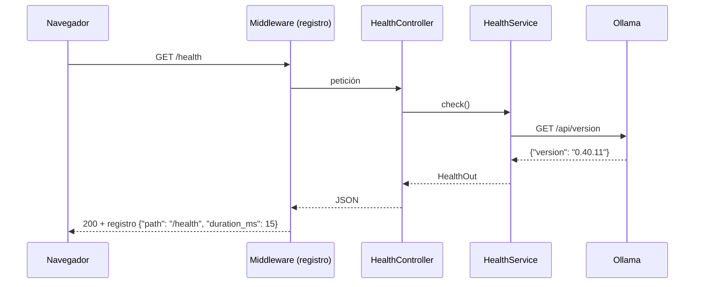

# Bitácora · Etapa 1: Backend MVC con FastAPI

**Fecha:** 2026‑10‑24 · **Rama:** `etapa/01-fastapi-mvc` · **Tecnología:** Python 3.12 + FastAPI + Pydantic + pytest + ruff

## Objetivo
Crear el esqueleto de la API con la estructura MVC definitiva, lista para ir agregando piezas en las siguientes etapas.

## Qué se construyó

```
app/
├── __main__.py              # python -m app  → arranca Uvicorn
├── main.py                  # create_app(): middleware, lifespan, routers
├── core/
│   ├── config.py            # Settings (pydantic-settings) leídas de .env
│   ├── logging.py           # registros JSON, una línea por evento
│   └── dependencies.py      # inyección de dependencias (Depends)
├── controllers/
│   └── health_controller.py # C · GET /health
├── services/
│   └── health_service.py    # lógica: revisa Ollama
├── schemas/
│   └── health.py            # V · contrato JSON de /health
├── models/                  # M · (Etapa 2)
├── repositories/            # M · (Etapa 2)
└── views/                   # V · HTML (Etapa 4)
tests/
└── test_health.py           # 5 pruebas, Ollama simulado
```

### Recorrido de una petición



## Conceptos aprendidos

| Concepto | Dónde | Para qué |
|---|---|---|
| *Application factory* (`create_app`) | `main.py` | Crear apps nuevas en cada prueba, sin estado compartido |
| *Lifespan* | `main.py` | Abrir y cerrar recursos (cliente HTTP; en la Etapa 2, la BD) al arrancar y apagar |
| Inyección de dependencias | `core/dependencies.py` | El controlador recibe el servicio ya armado, y en las pruebas se reemplaza por uno falso |
| `pydantic-settings` | `core/config.py` | Configuración tipada: un valor inválido en `.env` falla al arrancar, no a mitad de una conversación |
| `httpx.MockTransport` | `tests/` | Simular Ollama: las pruebas corren sin nada instalado |
| Estado "degradado" | `health_service.py` | La API sigue viva aunque Ollama esté caído, e informa qué falla |

## Cómo ejecutarlo

```powershell
# una sola vez
& "$env:LOCALAPPDATA\Programs\Python\Python312\python.exe" -m venv .venv
.\.venv\Scripts\python -m pip install -e ".[dev]"
copy .env.example .env

# arrancar
.\.venv\Scripts\python -m app
# abrir http://127.0.0.1:8000/docs

# pruebas y estilo
.\.venv\Scripts\python -m pytest
.\.venv\Scripts\python -m ruff check .
```

## Resultado

```json
{
  "status": "ok",
  "app": "JARVIS",
  "version": "0.1.0",
  "environment": "development",
  "dependencies": { "ollama": { "status": "up", "detail": "Ollama 0.40.11", "latency_ms": 11 } }
}
```

- ✅ `python -m app` arranca y `/health` responde `ok`
- ✅ `pytest`: 5 pruebas pasan
- ✅ `ruff`: sin errores

## Problemas encontrados

| Problema | Causa | Solución |
|---|---|---|
| `py` no existe después de instalar Python 3.12 | El lanzador `py` no quedó en el PATH | Se usa la ruta completa de Python 3.12 para crear `.venv`; después todo pasa por `.venv\Scripts\python` |
| Tildes rotas en los registros (`petición`) | La consola de Windows no usa UTF-8 por defecto | `sys.stdout.reconfigure(encoding="utf-8")` en `setup_logging` |
| Ollama corría en CPU (9,5 tokens/s) | Ollama sólo traía CUDA 13 y el driver soporta 12.8; tras actualizarse, faltaba VRAM por el margen de seguridad de 1 GB | Ollama 0.40.11 trae CUDA 12. Se bajó el margen con `LLAMA_ARG_FIT_TARGET=256` y se cambió a `qwen3:4b-instruct` → **40 tokens/s, 88 % en GPU** |

## Siguiente etapa
**Etapa 2:** PostgreSQL + pgvector con Docker, modelos SQLAlchemy y migraciones de Alembic.
