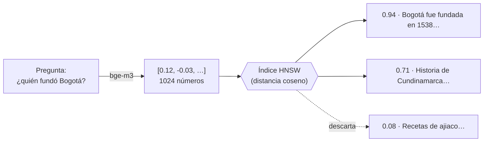

# Bitácora · Etapa 2: PostgreSQL + pgvector

**Fecha:** 2026‑10‑25 · **Rama:** `etapa/02-postgres-pgvector` · **Tecnología:** Docker Compose + PostgreSQL 17 + pgvector 0.8 + SQLAlchemy 2.1 + Alembic

## Objetivo
Darle a JARVIS memoria permanente: conversaciones, documentos y **vectores** para buscar por significado.

## Qué se construyó

```
docker-compose.yml                    # contenedor jarvis_db (pgvector/pgvector:pg17)
docker/postgres/init/                 # crea la extensión vector y la base jarvis_test
alembic.ini · migrations/             # migraciones del esquema
app/core/database.py                  # motor asíncrono (asyncpg) y sesiones
app/models/                           # M · 14 entidades en 5 archivos
├── base.py                           #   Base, convención de nombres, mixins
├── user.py · conversation.py · memory.py · knowledge.py · training.py
app/repositories/                     # M · acceso a datos
├── base_repository.py                #   get / add / list / delete genéricos
├── chunk_repository.py               #   nearest() vectorial y full_text() por palabras
└── model_version_repository.py       #   modelo activo (sólo uno)
scripts/seed.py                       # registra los modelos de Ollama
scripts/backup_db.ps1                 # copia de seguridad con pg_dump
tests/conftest.py · test_database.py  # 9 pruebas contra la base jarvis_test
```

## Cómo funciona la búsqueda por significado

Cada fragmento de texto se guarda con un **vector de 1024 números** (en la Etapa 5 lo calcula `bge-m3`). Textos con significado parecido tienen vectores que "apuntan" en direcciones parecidas.



| Pieza | Qué hace |
|---|---|
| `halfvec(1024)` | Guarda el vector con 2 bytes por número (la mitad que `vector`) |
| Índice **HNSW** | Grafo que encuentra los vecinos más cercanos sin comparar contra todos los fragmentos |
| `cosine_distance` | 0 = misma dirección (mismo significado), 1 = nada que ver. El repositorio lo convierte en `score = 1 − distancia` |
| Columna `tsv` + índice GIN | Búsqueda por palabras exactas, que complementa a la vectorial |

## Conceptos aprendidos

| Concepto | Dónde | Para qué |
|---|---|---|
| Migraciones (Alembic) | `migrations/` | Cada cambio del esquema queda versionado en Git y se aplica igual en cualquier PC |
| `alembic check` | — | Confirma que los modelos y la base coinciden ("No new upgrade operations detected") |
| Convención de nombres | `models/base.py` | Índices y restricciones con nombres predecibles (`ck_users_role`, `fk_…`) |
| `lazy="raise"` | relaciones | En modo asíncrono, cargar relaciones "a escondidas" falla. Así se nota de inmediato |
| Transacción por prueba | `tests/conftest.py` | Cada prueba escribe y al final todo se deshace: la base de pruebas queda limpia |
| Base de pruebas aparte | `jarvis_test` | Las pruebas nunca tocan tus datos reales |
| Restricciones en la BD | `CHECK`, `UNIQUE`, índice parcial | Las reglas se cumplen aunque el código tenga un error |

## Cómo ejecutarlo

```powershell
docker compose up -d                          # arranca PostgreSQL (puerto 5434)
.\.venv\Scripts\alembic upgrade head          # crea / actualiza las tablas
.\.venv\Scripts\python -m scripts.seed        # registra los modelos de Ollama
.\.venv\Scripts\python -m pytest              # 14 pruebas
.\scripts\backup_db.ps1                       # copia en .\backups
```

Conectarse a la base para explorarla:

```powershell
docker exec -it jarvis_db psql -U jarvis -d jarvis
# \dt         lista las tablas
# \d chunks   describe la tabla de fragmentos
```

## Resultado

```json
"dependencies": {
  "ollama":   { "status": "up", "detail": "Ollama 0.40.11", "latency_ms": 44 },
  "database": { "status": "up", "detail": "PostgreSQL + pgvector 0.8.7", "latency_ms": 25 }
}
```

- ✅ `alembic upgrade head` crea las 14 tablas, los 2 índices HNSW y el índice de texto completo
- ✅ `alembic check`: modelos y base sincronizados
- ✅ Una prueba inserta vectores y recupera el más parecido (score > 0,99)
- ✅ Los documentos personales sólo los ve su dueño
- ✅ `pytest`: 14 pruebas pasan · `ruff`: sin errores
- ✅ El contenedor usa ≈ 47 MB de RAM en reposo (límite: 1 GB)

## Problemas encontrados

| Problema | Causa | Solución |
|---|---|---|
| Puerto 5432 ocupado | Hay un PostgreSQL instalado directamente en Windows | JARVIS usa otro puerto |
| Puerto 5433 ocupado | El contenedor `motor_asignacion_db` de otro proyecto | JARVIS usa el **5434**, configurable con `POSTGRES_PORT` |
| La prueba de "fundación" no encontraba "fundada" | El diccionario español agrupa conjugaciones (fundada, fundaron → `fund`), pero "fundación" es otra raíz (`fundacion`) | La prueba documenta ese comportamiento. Esos casos los resuelve la búsqueda vectorial: por eso la Etapa 5 es **híbrida** |
| Archivos con tildes rotas o con BOM | PowerShell 5.1 lee y escribe con otra codificación por defecto | Los archivos se editan con herramientas que respetan UTF‑8 |

## Siguiente etapa
**Etapa 3:** conversar con JARVIS a través de Ollama (`LLMProvider`, streaming, `Modelfile` de personalidad) y guardar el historial en estas tablas.
