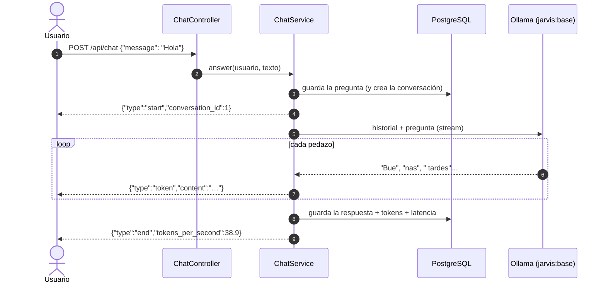

# Bitácora · Etapa 3: conversar con JARVIS a través de Ollama

**Fecha:** 2026‑10‑25 · **Rama:** `etapa/03-ollama-chat` · **Tecnología:** Ollama (API HTTP, NDJSON) + `qwen3:4b-instruct`

## Objetivo
Que JARVIS converse con personalidad propia, responda palabra por palabra y guarde cada conversación en PostgreSQL.

## Qué se construyó

```
ollama/Modelfile                      # personalidad y parámetros → modelo jarvis:base
app/services/llm/
├── base.py                           # interfaz LLMProvider, ChatMessage, ChatChunk
└── ollama_provider.py                # implementación con streaming NDJSON
app/services/prompt_builder.py        # historial recortado a ~2 400 tokens + pregunta
app/services/chat_service.py          # orquesta: guarda → genera → guarda
app/repositories/conversation_repository.py · user_repository.py
app/controllers/chat_controller.py    # POST /api/chat · GET/DELETE /api/conversations
app/schemas/chat.py
scripts/compare_models.py             # compara modelos con las mismas preguntas
tests/  (+16 pruebas)                 # proveedor, prompt, servicio y endpoints
```

### Recorrido de un mensaje



## La API

| Método | Ruta | Qué hace |
|---|---|---|
| `POST` | `/api/chat` | Envía un mensaje. Responde en **NDJSON**: `start`, varios `token`, y `end` o `error` |
| `GET` | `/api/conversations` | Lista las conversaciones, de la más reciente a la más antigua |
| `GET` | `/api/conversations/{id}/messages` | Mensajes de una conversación |
| `DELETE` | `/api/conversations/{id}` | Borra la conversación y sus mensajes |

Ejemplo desde PowerShell:

```powershell
$body = '{"message": "Hola JARVIS"}'
Invoke-WebRequest http://127.0.0.1:8000/api/chat -Method Post -Body $body -ContentType "application/json" | Select-Object -Expand Content
```

O desde Swagger: <http://127.0.0.1:8000/docs> → `POST /api/chat` → *Try it out*.

## Personalidad: el Modelfile

`ollama/Modelfile` crea el modelo `jarvis:base` a partir de `qwen3:4b-instruct`, con:

| Parte | Valor | Por qué |
|---|---|---|
| `num_ctx` | 8192 | Memoria de corto plazo que cabe en la GPU |
| `temperature` | 0,6 | Natural, sin inventar demasiado |
| `repeat_penalty` | 1,1 | Evita repeticiones |
| `SYSTEM` | Personalidad, forma de responder, honestidad y **lista de lo que puede y no puede hacer** | Sin esa lista, decía que podía "controlar dispositivos" |
| `MESSAGE` | Un ejemplo de conversación tratando de usted | Un modelo pequeño imita mejor un ejemplo que una regla |

Después de cambiar el Modelfile: `ollama create jarvis:base -f ollama/Modelfile`.

## Resultado real

Conversación de dos turnos a través de la API (modelo ya cargado; el nombre se cambió por uno de ejemplo):

> **Usuario:** Hola JARVIS, me llamo Ana y mi comida favorita es el ajiaco.
> **JARVIS:** Encantado de conocerte, Ana. El ajiaco es una delicia, especialmente cuando está bien cocinado…
>
> **Usuario:** ¿Recuerdas cómo me llamo y qué me gusta comer?
> **JARVIS:** Sí, Ana, y te gusta el ajiaco…

| Métrica | Turno 1 | Turno 2 |
|---|---|---|
| Primera palabra | 1,0 s | 0,6 s |
| Respuesta completa | 1,6 s | 1,1 s |
| Velocidad | 38,9 tok/s | 38,4 tok/s |

- ✅ Recuerda lo dicho dentro de la conversación (el historial viaja en cada petición)
- ✅ El historial queda en PostgreSQL con tokens, latencia y versión del modelo
- ✅ `pytest`: 30 pruebas pasan · `ruff`: sin errores

## Comparación de modelos

Las mismas 5 preguntas, con la misma personalidad, en los 4 modelos instalados. Respuestas completas en [03-comparacion-modelos-datos.md](03-comparacion-modelos-datos.md).

| Modelo | En GPU | Velocidad | Dato histórico | Honestidad | Capacidades | Usted | Veredicto |
|---|---|---|---|---|---|---|---|
| **`qwen3:4b-instruct`** | 88 % | 38,6 tok/s | ✅ 1538, Jiménez de Quesada | ✅ | ✅ Dice que no puede poner música | ⚠️ Mezcla | **Elegido** |
| `qwen3:4b` (razonamiento) | 88 % | 34,8 tok/s | ✅ | ✅ | ✅ | ⚠️ | ❌ "Piensa" en inglés 20–110 s antes de responder, aunque se le pida que no |
| `llama3.2` (3B) | 100 % | 54,9 tok/s | ✅ | ✅ | ❌ Dice que puede "generar música" | ✅ | ❌ Inventa capacidades |
| `qwen2.5:3b` | 100 % | 56,5 tok/s | ❌ Dice que la fundó Belalcázar | ✅ | ❌ "Por supuesto, ¿qué estilo?" | ✅ | ❌ Inventa datos y capacidades |

**Por qué `qwen3:4b-instruct`:** los modelos de 3B son un 45 % más rápidos y caben enteros en la GPU, pero **inventaron cosas**: un dato histórico falso y capacidades que JARVIS no tiene. Para un asistente cuyo objetivo es dar las respuestas más acertadas posibles, 38 tok/s es de sobra (más rápido de lo que se lee o se escucha), y la precisión vale más que la velocidad.

**Una lección sobre la prueba de razonamiento:** la pregunta de los huevos estaba mal planteada por nosotros (31 no se divide en dos mitades enteras). Todos los modelos lo notaron, pero `qwen3:4b-instruct` dio vueltas durante 10 s. Queda como caso para el conjunto de evaluación de la Etapa 5, ya corregido.

## Conceptos aprendidos

| Concepto | Dónde | Para qué |
|---|---|---|
| Interfaz (`Protocol`) | `llm/base.py` | Cambiar Ollama por otro servidor sin tocar el resto |
| Streaming NDJSON | `ollama_provider.py`, `chat_controller.py` | Ver la respuesta mientras se genera: la primera palabra llega en menos de 1 s |
| Validar antes de transmitir | `chat_controller.py` | Una vez empieza el streaming ya no se puede devolver un 404 |
| Sesiones propias en el servicio | `chat_service.py` | La respuesta sigue generándose después de que el controlador terminó |
| Presupuesto de tokens | `prompt_builder.py` | El historial nunca desborda el contexto de 8192 |
| Dobles de prueba (`FakeLLM`) | `tests/fakes.py` | Probar el chat sin depender de la GPU |

## Problemas encontrados

| Problema | Causa | Solución |
|---|---|---|
| Decía que podía controlar dispositivos | El modelo no sabe qué funciones existen | El `SYSTEM` lista lo que puede y no puede hacer. **Hay que actualizarlo en cada etapa** |
| Tutea a veces aunque se le pida "usted" | Un modelo de 4B sigue el estilo de forma imperfecta | Se agregó un ejemplo (`MESSAGE`). Lo resuelve de verdad el ajuste fino de la **Etapa 12** |
| Dice "lo tengo en mi memoria personal" | Exagera: sólo recuerda la conversación actual | La memoria de largo plazo llega en la Etapa 10 |
| `qwen3:4b` ignora `think: false` | Esa variante siempre razona en Ollama 0.40 | Se usa la variante `-instruct` |
| Pruebas de endpoints chocaban entre sí | Compartían una sola conexión a la BD | Usan conexiones reales y vacían las tablas al final |
| La conversación de prueba quedó en tu base real | La prueba manual usó la API de verdad | No sale del PC. Se puede borrar con `DELETE /api/conversations/1` |

## Siguiente etapa
**Etapa 4:** la vista web: una página de chat en el navegador con las respuestas apareciendo en vivo.
