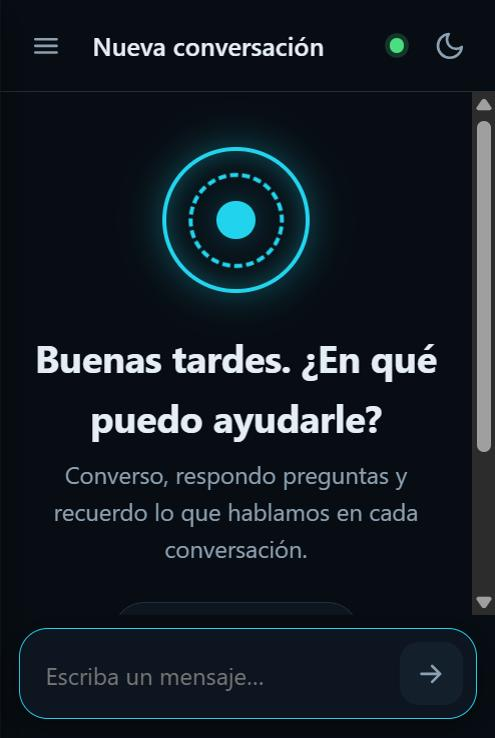
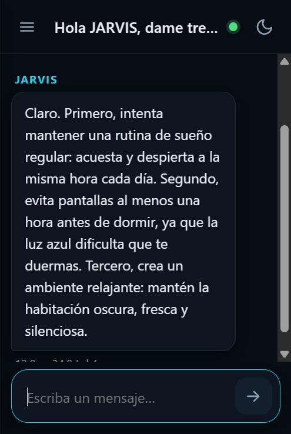
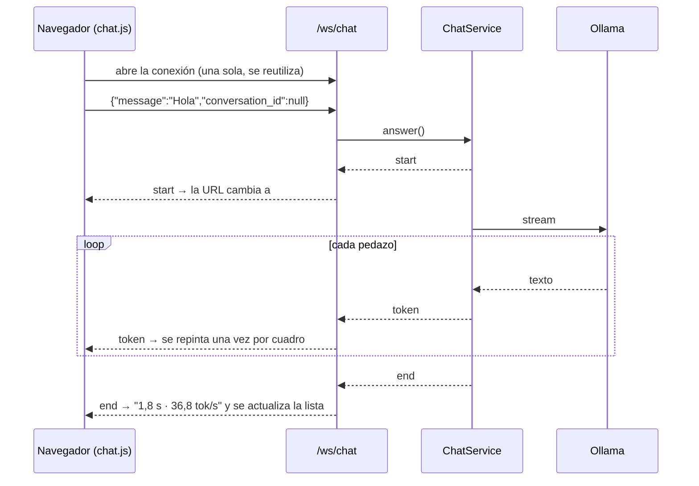

# Bitácora · Etapa 4: vista web del chat

**Fecha:** 2026‑10‑25 · **Rama:** `etapa/04-vista-web` · **Tecnología:** Jinja2 + WebSocket + JavaScript y CSS propios

## Objetivo
Conversar con JARVIS desde el navegador, con las respuestas apareciendo en vivo, en el PC y en el celular.

<p>
  
  &nbsp;
  
</p>

## Qué se construyó

```
app/controllers/page_controller.py    # GET / → chat.html · /favicon.ico
app/controllers/chat_controller.py    # + WebSocket /ws/chat
app/views/
├── templates/
│   ├── base.html                     # estructura común, tema sin parpadeo
│   └── chat.html                     # barra lateral + chat + caja de texto
└── static/
    ├── css/app.css                   # tokens de color, claro/oscuro, celular
    ├── js/markdown.js                # Markdown → HTML seguro (escapa todo primero)
    ├── js/chat.js                    # WebSocket, historial, estado, tema
    └── img/jarvis.svg                # logo "reactor"
tests/test_views.py                   # 12 pruebas: página, estáticos, privacidad, WebSocket
```

## Cómo funciona



| Función | Cómo |
|---|---|
| Respuesta en vivo | WebSocket. Mismos eventos que `POST /api/chat` (`start`, `token`, `end`, `error`) |
| Historial | La barra lateral usa `GET /api/conversations`. Cada conversación se abre y se borra desde ahí |
| Volver a la conversación | La URL guarda `#c=ID`: al recargar, se reabre sola |
| Estado | Punto verde, ámbar o rojo según `/health`, revisado cada 30 s |
| Reconexión | Si se cae el WebSocket, reintenta con espera creciente (1 s, 2 s… hasta 10 s) |
| Modelo dormido | Si a los 3 s no hay respuesta: *"Despertando el modelo…"* |
| Tema | Sigue al sistema. El botón lo fija y se recuerda en el navegador |
| Celular | Debajo de 820 px la barra lateral se vuelve un panel deslizable |

## Decisión: sin HTMX ni librerías externas

El plan original decía HTMX. Se cambió por **JavaScript propio** porque:
- **Privacidad y modo sin conexión:** la página no carga nada de internet (ni CDN, ni fuentes de Google). Una prueba automática lo vigila: `test_la_pagina_no_carga_nada_de_internet`.
- **El chat es un flujo de eventos**, no fragmentos de HTML: WebSocket + JS es más directo que HTMX con extensiones.
- Son unas 400 líneas de JS legibles y comentadas, fáciles de estudiar.

## Seguridad del contenido
Las respuestas del modelo se muestran con `markdown.js`, que **primero escapa todo el texto** y sólo después convierte un subconjunto pequeño de Markdown (párrafos, listas, negrita, código). Así, aunque el modelo escribiera `<script>`, el navegador lo mostraría como texto. Los mensajes del usuario se insertan con `textContent`, nunca como HTML.

## Resultado

| Prueba en el navegador | Resultado |
|---|---|
| Página, estilos, scripts e ícono | ✅ Cargan sin errores en la consola |
| Primera respuesta (modelo descargado de la GPU) | 12,0 s: ~10 s de carga del modelo + la respuesta |
| Respuesta con el modelo cargado | **1,8 s completa · 36,8 tok/s** |
| Recargar con `#c=2` | ✅ Reabre la conversación con su título |
| Tema claro y oscuro | ✅ |
| Celular (375 × 812) | ✅ Barra lateral deslizable, sin desplazamiento horizontal |
| `pytest` | ✅ 41 pruebas · `ruff` sin errores |

## Conceptos aprendidos

| Concepto | Dónde | Para qué |
|---|---|---|
| Plantillas con herencia | `base.html` → `chat.html` | La estructura común se escribe una sola vez |
| WebSocket | `/ws/chat`, `chat.js` | Conexión abierta en ambos sentidos: ideal para respuestas en streaming |
| `HTTPConnection` en dependencias | `core/dependencies.py` | Las mismas dependencias sirven para HTTP y WebSocket |
| Rutas relativas para estáticos | plantillas | Funcionan igual detrás del HTTPS de la Etapa 11 |
| `requestAnimationFrame` | `chat.js` | Repintar como máximo 60 veces por segundo aunque lleguen más tokens |
| Tokens de diseño en CSS | `app.css` | Un tema oscuro completo cambiando sólo variables |

## Problemas encontrados

| Problema | Causa | Solución |
|---|---|---|
| La prueba de privacidad falló | `url_for` genera direcciones absolutas (`http://…`) | Rutas relativas `/static/…`. Además evita el "contenido mixto" cuando haya HTTPS |
| Los títulos largos desbordaban la barra lateral | En CSS Grid, una columna crece con su contenido | `grid-template-columns: minmax(0, 1fr)` |
| 10 s de "escribiendo…" sin explicación | Ollama descarga el modelo tras 5 min sin uso | Aviso a los 3 s. Para evitar la espera se puede subir `OLLAMA_KEEP_ALIVE`, a cambio de ocupar la GPU más tiempo |
| `/favicon.ico` daba 404 | Los navegadores lo piden siempre | Ruta que devuelve el logo SVG |
| Sigue tuteando a veces | Limitación del modelo de 4B (ver Etapa 3) | Etapa 12 |

## Siguiente etapa
**Etapa 5:** embeddings y RAG: que JARVIS busque en documentos y cite de dónde saca cada dato.
