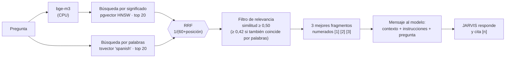

# Bitácora · Etapa 5: embeddings y RAG

**Fecha:** 2026‑10‑25 · **Rama:** `etapa/05-embeddings-rag` · **Tecnología:** `bge-m3` (Ollama, CPU) + pgvector (HNSW) + texto completo de PostgreSQL + RRF

## Objetivo
Que JARVIS responda con datos verificables de los documentos de la casa y **cite de dónde sale cada dato**.

## Resultado principal

Le hicimos 50 preguntas cuya respuesta sólo está en la documentación del proyecto (por ejemplo: *"¿En qué puerto escucha la base de datos?"*):

| | Sin RAG | **Con RAG** |
|---|---|---|
| Respuestas correctas | 3 de 50 (**6 %**) | 42 de 50 (**84 %**) |
| Cita la fuente con [n] | — | 50 de 50 (100 %) |

**Meta de la etapa: ≥ 80 % ✅.** Informe completo, pregunta por pregunta: [05-evaluacion-rag.md](05-evaluacion-rag.md).

## Qué se construyó

```
app/services/embedding_service.py     # OllamaEmbedder: texto → 1024 números (bge-m3, CPU, por lotes)
app/services/chunker.py               # documentos → fragmentos de ~500 tokens por sección
app/services/knowledge_service.py     # indexar: fragmentar → vectorizar → guardar (sin duplicados)
app/services/retrieval_service.py     # búsqueda híbrida + RRF + filtro de relevancia
app/services/prompt_builder.py        # contexto numerado dentro del mensaje + instrucciones de cita
app/services/chat_service.py          # nuevo paso 2: buscar → evento "sources" → guardar fuentes
app/controllers/knowledge_controller.py  # POST /api/knowledge/text · GET /sources · GET /search
app/views/static/js/chat.js           # fuentes bajo cada respuesta, citadas resaltadas
scripts/index_docs.py                 # indexa README + docs/ (147 fragmentos)
scripts/evaluate_rag.py · eval/rag_eval.jsonl   # 50 preguntas + 10 fuera de tema
tests/ (+23 pruebas)                  # chunker, embeddings, indexación, búsqueda, citas, endpoints
```

## Cómo funciona



### Decisiones

| Decisión | Por qué |
|---|---|
| **Fragmentos por sección de Markdown** con la ruta como encabezado ("Documento > Sección") | Cada fragmento se entiende solo, y la búsqueda por palabras también encuentra los títulos |
| **Solapamiento** de un párrafo | No cortar una idea a la mitad |
| **Búsqueda híbrida** | Los vectores entienden paráfrasis; las palabras no fallan con números y siglas ("5434", "HNSW") |
| **RRF** en lugar de sumar puntajes | La similitud coseno y el `ts_rank` no se pueden comparar; las posiciones sí |
| **Filtro de relevancia** | Ante un "hola" no hay que darle documentos al modelo |
| Contexto **dentro del mensaje del usuario** | Ollama sólo usa el SYSTEM del Modelfile si el primer mensaje no es de sistema: así no se pierde la personalidad |
| Si fallan los embeddings, **responde igual** sin contexto | Un problema en la búsqueda no debe dejar a JARVIS mudo |
| Reindexar un archivo **reemplaza** su versión anterior (misma `uri`) | Los documentos editados no quedan duplicados |

## El hallazgo más importante: la GPU lee el contexto lento

La primera evaluación (6 fragmentos) acertó el 86 %, pero **cada respuesta tardaba 15,9 s**. Al medir:

| Paso | Velocidad en la GTX 1650 Ti |
|---|---|
| Generar la respuesta | 30–40 tokens/s (rápido para leerla) |
| **Leer el contexto** (*prompt processing*) | **~200–380 tokens/s**, sin importar el tamaño de contexto configurado |

Es un límite del hardware: la GTX 1650 Ti no tiene núcleos tensoriales. **Cada fragmento extra de ~500 tokens cuesta ~2 s de espera antes de la primera palabra.** Por eso:

| Configuración | Búsqueda acierta | Respuestas correctas | Tiempo medio |
|---|---|---|---|
| 6 fragmentos (3 000 tokens) | 47/50 | 43/50 (86 %) | 15,9 s |
| **3 fragmentos (1 800 tokens)** | 46/50 | 42/50 (84 %) | **9,3 s** |

Se eligieron **3 fragmentos**: pierde una sola respuesta a cambio de casi la mitad del tiempo.

**Ayuda extra:** dentro de una conversación Ollama reutiliza lo que ya leyó (caché del prefijo), y las preguntas siguientes empiezan a responder en menos de 1 s.

## Resultado

| Prueba | Resultado |
|---|---|
| Indexar la documentación (15 archivos) | 147 fragmentos en 183 s (**~1,2 s por fragmento en CPU**) |
| Búsqueda acierta (hit@3) | 46/50 (92 %) · MRR 0,84 |
| Respuestas correctas con RAG | **42/50 (84 %)** contra 3/50 sin RAG |
| En el navegador: "¿En qué puerto escucha la base de datos?" | *"…escucha en el puerto 5434 [1]"*, con las 3 fuentes listadas |
| `pytest` | ✅ 64 pruebas · `ruff` sin errores |

## Límites conocidos (honestos)

| Límite | Ejemplo | Qué lo mejorará |
|---|---|---|
| A veces la búsqueda no trae el fragmento con la respuesta | "¿Qué procesador tiene el servidor?" (está en una tabla) | Reranker (con 16 GB de RAM) y fragmentos más pequeños para tablas |
| El modelo de 4B a veces completa con conocimiento propio | Dijo que 5434 "es el estándar común" (el estándar es 5432) | Instrucciones más estrictas y ajuste fino (Etapa 12) |
| Preguntas fuera de tema que sí traen contexto (3 de 10) | "¿Qué es la fotosíntesis?" trae la comparación de modelos… ¡que sí habla de fotosíntesis! | No es un error: el corpus contiene esas palabras |
| Indexar en CPU es lento | 1,2 s por fragmento | Etapa 6: indexación masiva en la GPU, de noche |
| Leer contexto es lento en esta GPU | ~6 s para 3 fragmentos | Más VRAM o una GPU con núcleos tensoriales |

## Conceptos aprendidos

| Concepto | Para qué |
|---|---|
| **Embedding** | Representar el significado de un texto como un punto en un espacio de 1024 dimensiones |
| **Similitud coseno** | Medir qué tan parecidos son dos significados (1 = igual, 0 = nada que ver) |
| **RAG** (*Retrieval-Augmented Generation*) | Darle al modelo la información justa antes de responder, en lugar de reentrenarlo |
| **Búsqueda híbrida + RRF** | Combinar dos buscadores distintos sin comparar sus puntajes |
| **hit@k y MRR** | Medir si la búsqueda trae la respuesta y en qué posición |
| **Prompt processing vs generación** | Dos velocidades distintas. En esta GPU, la primera es el cuello de botella |
| **Evaluación con línea base** | Sin el "sin RAG" no sabríamos cuánto aporta el RAG (6 % → 84 %) |

## Cómo usarlo

```powershell
.\.venv\Scripts\python -m scripts.index_docs        # indexa README + docs/
.\.venv\Scripts\python -m scripts.evaluate_rag      # 50 preguntas → docs/etapas/05-evaluacion-rag.md
```

Agregar un texto propio desde Swagger (`/docs`) → `POST /api/knowledge/text`:

```json
{"title": "Horarios de la casa", "text": "El reciclaje se saca los jueves...", "personal": true}
```

Probar qué leería JARVIS: `GET /api/knowledge/search?q=¿qué día sale el reciclaje?`

## Siguiente etapa
**Etapa 6:** ingesta de conocimiento externo: cargar archivos, páginas web y Wikipedia con un worker en segundo plano, e indexar en la GPU.
