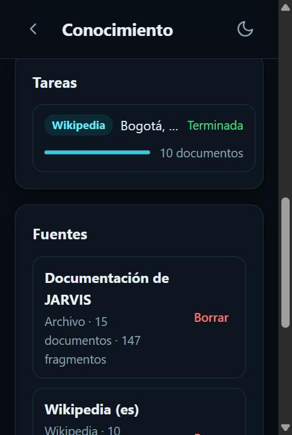
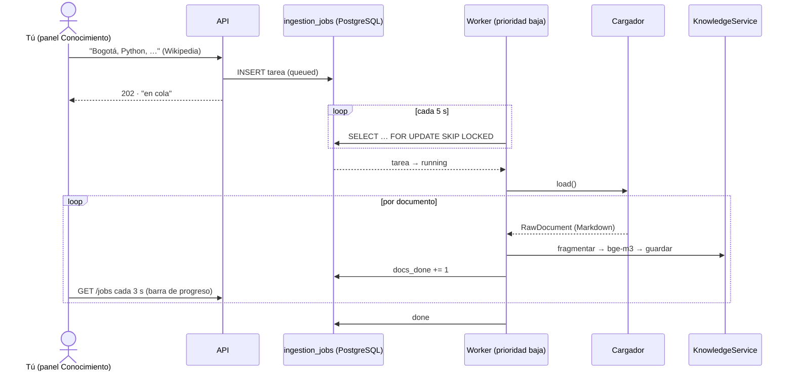

# Bitácora · Etapa 6: ingesta de conocimiento externo

**Fecha:** 2026‑10‑25 · **Rama:** `etapa/06-ingesta` · **Tecnología:** trafilatura + pypdf + python-docx + API de Wikipedia + worker con cola en PostgreSQL

## Objetivo
Que JARVIS aprenda de archivos, páginas web y Wikipedia **mientras hay internet**, y luego lo use todo en local.



## Antes de empezar: el PC se ponía lento

Al cerrar la Etapa 5 notaste el PC lento. Medimos y corregimos (commit `perf:`):

| Causa | Corrección | Resultado |
|---|---|---|
| Contexto 8192: el 12 % del modelo corría en el procesador | Contexto **6144** | 100 % en GPU, **42,8 tok/s** (antes 33–38), 734 MB de RAM |
| `bge-m3` usaba los 8 hilos al indexar | **4 hilos** (`OLLAMA_EMBED_THREADS`) | Procesador ~60 % en lugar de ~90 % |
| `bge-m3` quedaba 5 min en RAM | **2 min** (`OLLAMA_EMBED_KEEP_ALIVE`) | 1,2 GB libres antes |
| Ollama arranca sus procesos con prioridad **más alta de lo normal** | El worker baja a **"debajo de lo normal"** el proceso de Ollama que indexa | Tus programas tienen preferencia |
| El worker y la API quedaban con un proceso "lanzador" | `jarvis.ps1` cierra el **árbol completo** de procesos | `detener` no deja procesos vivos |
| Docker Desktop: ~1,1 GB para una base de 50 MB | PostgreSQL con menos memoria + `autoMemoryReclaim` en WSL | — |
| Todo quedaba encendido | **`scripts\jarvis.ps1 detener`** | **1,24 GB de RAM y toda la GPU liberadas** |

## Qué se construyó

```
app/services/ingestion/
├── base.py                 # RawDocument + interfaz DocumentLoader
├── file_loader.py          # .txt .md .pdf .docx .html → Markdown
├── web_loader.py           # trafilatura + robots.txt + mismo dominio + pausa entre páginas
├── wikipedia_loader.py     # API pública por títulos o categoría; quita "Referencias", etc.
└── ingestion_service.py    # encolar (API) y procesar (worker), con progreso y cancelación
app/repositories/job_repository.py   # cola con FOR UPDATE SKIP LOCKED
worker/__main__.py          # python -m worker [--gpu] [--once]
app/controllers/knowledge_controller.py  # + /files /web /wikipedia /jobs /sources/{id}
app/views/templates/knowledge.html · static/js/knowledge.js   # panel Conocimiento
scripts/jarvis.ps1          # iniciar · detener · estado (ahora también el worker)
tests/test_ingestion.py     # 22 pruebas sin internet (APIs simuladas)
```

## Cómo funciona



| Cargador | Qué hace | Cuidados |
|---|---|---|
| **Archivo** | TXT, Markdown, PDF, Word (los estilos "Título" pasan a `##`), HTML | Hasta 20 MB. La copia subida se borra al indexar. Puede ser **personal** |
| **Web** | Extrae el texto principal (sin menús ni publicidad) y sigue enlaces del mismo sitio | **Respeta `robots.txt`**, pausa de 1 s, User-Agent honesto, máximo 50 páginas |
| **Wikipedia** | Por títulos o por categoría; convierte `== Historia ==` en `## Historia` | Quita Referencias, Enlaces externos y similares. Guarda la licencia **CC BY-SA 4.0** |

### Decisiones

| Decisión | Por qué |
|---|---|
| **API de Wikipedia por temas**, no el volcado completo | Vectorizar toda la Wikipedia en español (~8 M de fragmentos) tardaría **más de un mes** en esta GPU |
| **Cola en PostgreSQL** (`SKIP LOCKED`) en lugar de Redis | Una pieza menos y unos 100 MB de RAM menos |
| **Worker aparte** con prioridad baja | Indexar no frena el chat ni el PC |
| **Modo `--gpu`** para la noche | La GPU vectoriza **4 veces más rápido** (0,36 s contra 1,41 s por fragmento), pero ocupa la VRAM del chat |
| Tareas interrumpidas **vuelven a la cola** al reiniciar el worker | Apagar el PC a mitad de una tarea no la pierde; los documentos ya guardados no se repiten (hash) |
| Un documento con error **no detiene** la tarea | Se registra y se sigue con el siguiente |
| `INGESTION_ALLOW_INTERNET=false` | Interruptor para trabajar 100 % sin conexión |

## Resultado

| Prueba | Resultado |
|---|---|
| 10 artículos de Wikipedia desde el panel (Bogotá, Colombia, Café de Colombia, García Márquez, IA, Aprendizaje automático, Modelo extenso de lenguaje, PostgreSQL, Python, J.A.R.V.I.S.) | **517 fragmentos en ~10 min** (CPU, 4 hilos, prioridad baja) |
| Procesador mientras indexa | ~63 % de media, con prioridad baja: el PC sigue usable |
| Conocimiento total | 25 documentos · 664 fragmentos |
| `pytest` | ✅ 87 pruebas · `ruff` sin errores · `alembic check` sin cambios |

Preguntas al chat después de indexar:

| Pregunta | Respuesta de JARVIS | Fuente | Tiempo |
|---|---|---|---|
| ¿En qué año recibió García Márquez el Nobel? | 1982 [1] | García Márquez › Premios (77 %) | 24,9 s* |
| ¿Quién creó Python? | Guido van Rossum | Python › Historia (62 %) | 12,7 s |
| ¿A qué altitud está Bogotá? | 2625 m [1]; también 2630 m [2] | Bogotá › Geografía (75 %) | 11,4 s |
| ¿En qué película apareció J.A.R.V.I.S. y quién le pone la voz? | *Iron Man* (2008), Paul Bettany [2] | Jarvis (personaje) › Universo Marvel (65 %) | 9,6 s |

\*Incluye cargar los dos modelos en memoria.

**Límite observado:** en la pregunta de Python acertó, pero dijo que el dato *no estaba en los documentos* aunque venía en la sección Historia. El modelo de 4B no siempre reconoce de dónde saca un dato; mejora con el ajuste fino (Etapa 12).

## Proyección: ¿cuánto se puede indexar?

| Corpus | Fragmentos aprox. | CPU (4 hilos) | GPU (modo noche) | Disco en la BD |
|---|---|---|---|---|
| 10 artículos (hecho) | 517 | ~10 min | ~3 min | ~3 MB |
| 2 000 artículos elegidos | 20 000 | ~8 h | **~2 h** | ~120 MB |
| 50 000 artículos | 500 000 | ~8 días | ~50 h | ~3 GB |
| Wikipedia ES completa | ~8 000 000 | meses | ~1 mes | ~50 GB |

## Cómo usarlo

```powershell
.\scripts\jarvis.ps1 iniciar          # API + worker (CPU, prioridad baja)
.\scripts\jarvis.ps1 iniciar -Gpu     # worker en modo noche (no chatees mientras indexa)
```

Luego abre **http://localhost:8000/conocimiento** (o el enlace *Conocimiento* en la barra lateral del chat):
1. **Archivo:** arrastra un PDF o Word. Marca "personal" si sólo debe verlo quien lo sube.
2. **Página web:** pega la dirección y cuántas páginas del mismo sitio seguir.
3. **Wikipedia:** un artículo por línea, o una categoría con un máximo.
4. Mira el progreso en **Tareas** y prueba en **Probar la búsqueda** qué leería JARVIS.

## Conceptos aprendidos

| Concepto | Para qué |
|---|---|
| **Cola de trabajos** | Separar lo que se pide (rápido) de lo que se hace (lento) |
| `FOR UPDATE SKIP LOCKED` | Usar PostgreSQL como cola segura aunque haya varios workers |
| **Prioridad de procesos** | Que el trabajo pesado use sólo el procesador que sobra |
| **Árbol de procesos** | En Windows, el `python.exe` del entorno virtual lanza un proceso hijo |
| **Extracción de contenido** (trafilatura) | Quedarse con el artículo y no con menús, anuncios ni pies de página |
| **robots.txt** | Ser un buen ciudadano de la web |
| **Licencias** (CC BY-SA) | Saber de dónde viene cada dato y bajo qué condiciones |

## Problemas encontrados

| Problema | Causa | Solución |
|---|---|---|
| PC lento al indexar | Ollama corre sus procesos con prioridad alta y todos los hilos | 4 hilos + el worker baja la prioridad del proceso de Ollama |
| `detener` podía dejar procesos vivos | El lanzador del entorno virtual tiene un proceso hijo | `taskkill /T` (árbol completo) |
| Una prueba falló: `IngestionJob(source=…)` | Faltaba la relación en el modelo | Relación agregada (sin cambios en la base) |
| Pestañas y cifras desbordadas en pantallas de ~310 px | Diseño pensado desde 375 px | En pantallas pequeñas las cifras van en filas y las pestañas se reparten el ancho |
| Meta de 50 000 artículos | Irreal para esta GPU (~50 h) | Criterio ajustado; queda como meta incremental en modo noche |
| Tras actualizar el CSS, el navegador seguía con el viejo | Caché del navegador | Cada CSS/JS se pide con `?v=<fecha del archivo más nuevo>`: al cambiar algo, cambia la dirección |
| El encabezado fijo tapaba un tercio de la pantalla en el celular | Subtítulo de 4 líneas | Se oculta en pantallas pequeñas |

## Siguiente etapa
**Etapa 7:** voz a texto con `faster-whisper`: que JARVIS entienda lo que le dices.
