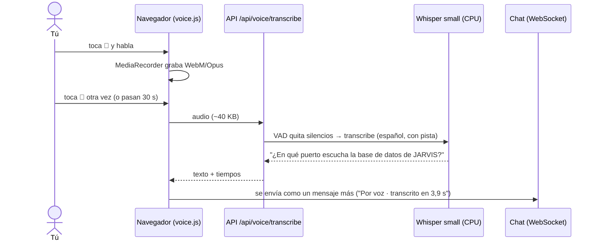

# Bitácora · Etapa 7: voz a texto

**Fecha:** 2026‑10‑25 · **Rama:** `etapa/07-voz-a-texto` · **Tecnología:** faster-whisper (Whisper + CTranslate2) · modelo `small` int8 en CPU · Silero VAD

## Objetivo
Que JARVIS entienda lo que le dices, sin enviar tu voz a ningún servidor externo.


## Qué se construyó

```
app/services/stt_service.py          # SpeechToText (interfaz) + FasterWhisperSTT
app/controllers/voice_controller.py  # POST /api/voice/transcribe
app/views/static/js/voice.js         # botón de micrófono: grabar → subir → enviar al chat
scripts/generate_stt_samples.ps1     # 15 frases de prueba con la voz en español de Windows
scripts/evaluate_stt.py              # compara modelos: errores (WER), tiempo y RAM
eval/stt_frases.txt                  # las frases de referencia
tests/test_stt.py                    # 11 pruebas con un Whisper falso
```

## Cómo funciona



| Detalle | Decisión |
|---|---|
| Interacción | **Tocar para hablar** y otra vez para enviar; Esc cancela; máximo 30 s |
| Transporte | **HTTP**, no WebSocket: con "tocar para hablar" el audio viaja completo una sola vez |
| Formato | El que graba el navegador (WebM/Opus, ~12 KB por segundo); `av` lo decodifica sin ffmpeg |
| Silencios | El **VAD** (Silero, incluido en faster-whisper) descarta lo que no es voz |
| Memoria | Whisper se carga **la primera vez que hablas** y se **descarga tras 5 min** sin uso (~380 MB) |
| Concurrencia | Una transcripción a la vez (candado), en un hilo aparte para no bloquear la API |

## Elección del modelo

15 frases típicas ("Recuérdame comprar leche…", "¿En qué puerto escucha la base de datos…?") generadas con la voz en español de Windows. Informe completo: [07-evaluacion-stt.md](07-evaluacion-stt.md).

| Modelo | Palabras mal (WER) | Frases perfectas | Tiempo por frase | RAM |
|---|---|---|---|---|
| `tiny` | 23,5 % | 5/15 | 0,8 s | ~140 MB |
| `base` | 18,7 % | 4/15 | 1,1 s | ~150 MB |
| `small` | 6,7 % | 10/15 | 3,4 s | ~380 MB |
| **`small` + pista** | **2,9 %** | **12/15** | **3,1 s** | ~380 MB |

**La pista** (`initial_prompt`) es una frase con el vocabulario de la casa: *"Conversación en español con JARVIS, el asistente de la casa."* Sin ella, Whisper escribía "Harvis" o "Harbys". Con ella, los únicos "errores" que quedan son "8" por "ocho", "100" por "Cien" y "ajiaco", que no cambian el sentido.

**Otras pruebas:**
- **8 hilos en lugar de 4:** no mejora (3,52 s contra 3,43 s); el procesador ya está al límite.
- **Sin marcas de tiempo:** no ahorra tiempo y empeora levemente la precisión.
- **GPU:** sería ~10 veces más rápido, pero el modelo de chat ocupa la VRAM.

## Resultado real (audio en el formato del navegador)

| Frase | Tiempo | Resultado |
|---|---|---|
| "Hola JARVIS, ¿cómo estás hoy?" (primera, carga el modelo) | 7,1 s | ✅ perfecta |
| "¿En qué puerto escucha la base de datos de JARVIS?" | 5,1 s | ✅ perfecta |
| "Gracias JARVIS, eso es todo por hoy." | 3,9 s | ✅ perfecta |

**Voz → respuesta completa** (con RAG y el modelo de chat ya cargado): transcribir ~4 s + primera palabra de la respuesta ~10 s. Respondió *"…escucha en el puerto 5434 [2]"*.

En la vista web se probó toda la ruta del botón (grabar → subir → transcribir → mensaje) reemplazando el micrófono por un tono generado en el navegador: el filtro de silencios lo descartó y apareció *"No te entendí"*, como debía. Con el micrófono real hay que probarlo en tu navegador (Chrome o Edge) en `http://localhost:8000`.

## Problemas encontrados

| Problema | Causa | Solución |
|---|---|---|
| `TypeError: open() got an unexpected keyword argument 'metadata_errors'` | `av` 19 quitó un parámetro que faster-whisper 1.2 usa | Versión fijada: `av>=12,<14` |
| La primera respuesta después de encender tardó 53 s | Ollama cargaba el modelo de chat y `bge-m3` con 0,8 GB de RAM libre, así que Windows usó el disco | `jarvis.ps1 iniciar` **precarga el modelo de chat** en la GPU |
| "Harvis" en lugar de "JARVIS" | Whisper no conoce la palabra | `initial_prompt` con el vocabulario de la casa |
| No cumple "< 2 s" | `small` en CPU tarda 3–5 s | Se prefirió precisión (2,9 % contra 18,7 % de `base`); criterio ajustado |
| Micrófono desde el celular | Los navegadores sólo lo permiten en `localhost` o con HTTPS | La página lo explica; se resuelve en la Etapa 11 |

## Límites conocidos
- **Las pruebas usan una voz sintética**, clara y sin ruido. Con tu voz, acento, eco o ruido de fondo, la tasa de error será mayor. Conviene repetir la evaluación grabando tus propias frases.
- **La RAM sigue siendo el límite:** con todo cargado (chat, `bge-m3`, Whisper, Docker) quedan ~0,8 GB libres.

## Conceptos aprendidos

| Concepto | Para qué |
|---|---|
| **WER** (*Word Error Rate*) | Medir la calidad de una transcripción comparándola con la frase real |
| **RTF** (*Real-Time Factor*) | Tiempo de proceso entre duración del audio: < 1 es más rápido que hablar |
| **Cuantización int8** | Modelo 4 veces más liviano con una pérdida de precisión mínima |
| **VAD** (*Voice Activity Detection*) | No gastar tiempo transcribiendo silencios |
| **Initial prompt** | Darle contexto al modelo sin reentrenarlo |
| **Carga perezosa + descarga por inactividad** | Usar RAM sólo mientras hace falta |
| **MediaRecorder** | Grabar audio en el navegador sin librerías |

## Siguiente etapa
**Etapa 8:** texto a voz con Piper: que JARVIS te responda hablando.
