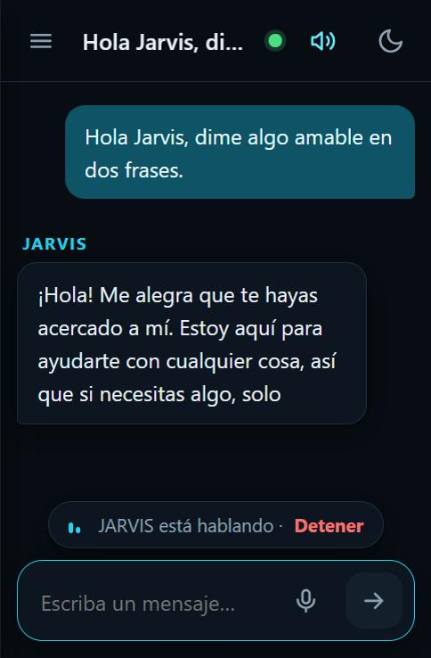
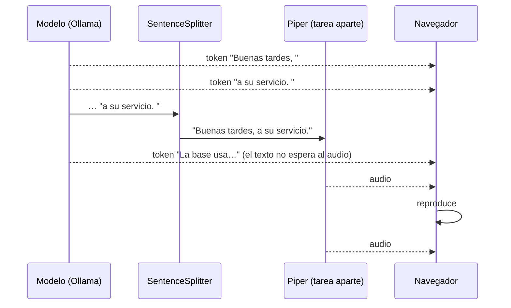

# Bitácora · Etapa 8: texto a voz

**Fecha:** 2026‑10‑25 · **Rama:** `etapa/08-texto-a-voz` · **Tecnología:** Piper (ONNX, CPU) · voz `es_ES-davefx-medium`

## Objetivo
Que JARVIS **responda hablando**, con una voz natural, sin servicios externos.



## La voz se eligió escuchando

Se generó la misma frase con 7 voces en español y el dueño eligió escuchándolas (`scripts/compare_tts_voices.py`):

| # | Motor · voz | Tipo | Proceso / audio (RTF) |
|---|---|---|---|
| 1 | Piper · es_MX-claude-high | Hombre, México | 0,08 |
| 2 | Piper · es_MX-ald-medium | Hombre, México | 0,08 |
| **3** | **Piper · es_ES-davefx-medium** ✅ | **Hombre, España** | **0,09** |
| 4 | Piper · es_AR-daniela-high | Mujer, Argentina | 0,46 |
| 5–7 | Kokoro · em_alex / em_santa / ef_dora | Neutro | 0,87–0,94 |

RTF = tiempo de proceso entre duración del audio. Con **0,09**, Piper genera 11 segundos de voz por cada segundo de trabajo. Kokoro suena muy natural, pero en esta CPU tarda casi lo mismo que el audio: unos 3 s de silencio antes de cada respuesta.

## Qué se construyó

```
app/services/tts_service.py      # TextToSpeech (interfaz) · PiperTTS · clean_for_speech · SentenceSplitter
app/services/speech_pipeline.py  # el chat en streaming + una tarea que habla frase por frase
app/controllers/voice_controller.py   # + POST /api/voice/speak (devuelve WAV)
app/controllers/chat_controller.py    # WebSocket: con "voice": true envía también audio
app/views/static/js/speaker.js   # cola de reproducción, Detener, activar/desactivar voz
scripts/download_tts_voices.py   # descarga las voces (corrige un JSON dañado de una de ellas)
scripts/compare_tts_voices.py    # muestras para elegir la voz escuchando
tests/test_tts.py                # 18 pruebas
```

## Cómo funciona



| Pieza | Qué hace |
|---|---|
| `clean_for_speech` | Quita **citas [1]**, Markdown, enlaces ("el enlace en pantalla"), emojis y bloques de código. "JARVIS" → "Jarvis" para que no lo deletree |
| `SentenceSplitter` | Corta en `. ! ? …` sin romper "3.5" ni "Sr.". Junta frases muy cortas ("Sí. Claro.") para que suene natural |
| Tarea de voz aparte | El texto sigue llegando mientras Piper genera; un candado ordena los envíos por el WebSocket |
| Carga perezosa | La voz se carga al primer uso (~3 s) y se libera tras 10 min sin uso |
| Si falla la voz | Se avisa una vez (`audio_error`) y **el texto llega igual** |

En la vista web:
- 🔊 **Altavoz** en el encabezado: respuestas en voz alta sí o no (se recuerda).
- **"JARVIS está hablando · Detener"** mientras habla. Enviar otro mensaje también lo interrumpe.
- **"Escuchar"** en cada respuesta, para oírla otra vez.

## Resultado

Medido por el WebSocket, como lo usa el navegador:

| Pregunta | Primera palabra | **Empieza a hablar** |
|---|---|---|
| "¿Qué puedes hacer por mí hoy?" (sin documentos) | 0,9 s | **2,2 s** |
| Siguiente frase de la misma respuesta | — | +0,3 s |
| "Cuéntame un dato curioso sobre el café de Colombia" (con documentos) | 10,0 s | 12,0 s |
| Primera respuesta tras encender (carga la voz) | — | +3–5 s una sola vez |

- ✅ **El audio llega ~1,3 s después del texto** y cada frase se genera en ~0,3 s
- ✅ En el navegador: voz, "Detener", "Escuchar" y el interruptor de voz probados, sin errores en la consola
- ✅ `pytest`: 116 pruebas · `ruff` sin errores

**Conclusión para la Etapa 9:** la conversación normal ya es fluida (~2 s). Lo lento son las preguntas que consultan documentos (~10 s), porque esta GPU lee el contexto a ~250 tokens/s. Optimizarlo es parte de la "conversación fluida".

## Problemas encontrados

| Problema | Causa | Solución |
|---|---|---|
| Una voz no cargaba (`'PhonemeType.ESPEAK' is not a valid PhonemeType`) | Su JSON se exportó con un error | El script de descarga corrige el archivo |
| JARVIS respondió "no puedo reproducir música" a "¿qué puedes hacer por mí?" | La **comparación de modelos** estaba indexada y contiene respuestas viejas de prueba; JARVIS las tomó como conocimiento | Los archivos de resultados ya no se indexan, y `index_docs` borra del índice lo que ya no corresponde |
| A veces escribe una cita [1] sin haber consultado documentos | El modelo imita el formato de las instrucciones | En voz no se nota (las citas se quitan); se revisará con el ajuste fino |
| Un comando de prueba quedó esperando para siempre | Al redirigir la salida de `jarvis.ps1` a otro programa, los procesos hijos heredan esa conexión | Sólo pasa al encadenar comandos; en la terminal normal no |

## Conceptos aprendidos

| Concepto | Para qué |
|---|---|
| **TTS neuronal** (VITS/Piper) | Voz natural generada por una red pequeña, en tiempo real en CPU |
| **RTF** | Comparar motores de voz: < 1 genera más rápido de lo que se habla |
| **Streaming por frases** | Empezar a hablar antes de tener la respuesta completa |
| **Productor y consumidor** | El texto (productor) y la voz (consumidor) avanzan a su ritmo, unidos por una cola |
| **Normalizar texto para voz** | Lo que se ve bien escrito (Markdown, [1], URLs) suena mal leído |

## Siguiente etapa
**Etapa 9:** "Jarvis" siempre atento. Micrófono siempre activo, reacciona a su nombre, modo conversación, interrumpirlo al hablar, y respuestas más rápidas cuando consulta documentos.
