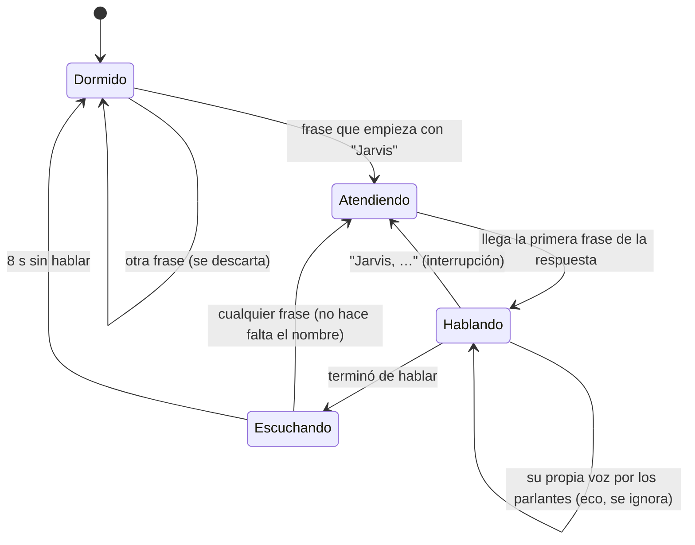

# Bitácora · Etapa 9: "Jarvis" siempre atento y conversación fluida

**Fecha:** 2026‑10‑25 · **Rama:** `etapa/09-jarvis-siempre-atento` · **Tecnología:** Silero VAD · Whisper `small` en la GPU · openWakeWord (opcional) · sounddevice

## Objetivo
Hablarle sin tocar nada: *"Jarvis, ¿cómo estás?"* y responde por los parlantes. Seguir conversando sin repetir su nombre, e interrumpirlo si hace falta.

## Cómo se usa

```powershell
.\scripts\jarvis.ps1 iniciar            # ahora también enciende el agente de voz
.\scripts\jarvis.ps1 iniciar -SinVoz    # todo menos el micrófono
.\scripts\jarvis.ps1 detener            # apaga también el micrófono
```

> **Cambio en la Etapa 10:** el modo conversación quedó **apagado** por defecto: toda frase tiene que **empezar** con "Jarvis". En casa respondía a lo que se hablaba en el cuarto. Ver [bitácora de la Etapa 10](10-memoria.md#solo-responde-si-la-frase-empieza-con-jarvis).

Diga **"Jarvis, …"** (pronunciado *"Yarbis"*). Suena un aviso corto, JARVIS responde por los parlantes y **sigue escuchando 8 segundos** (sólo con `--seguir 8`): puede seguir hablando sin decir su nombre. Para interrumpirlo mientras habla, diga **"Jarvis"**. Lo que pasa queda en `logs\voz.log`:

```
En espera. Diga "Jarvis, …"
Le escucho…
Usted: Jarvis, ¿cómo estás?
JARVIS: Estoy muy bien, gracias por preguntar. ¿En qué puedo ayudarle hoy?
   tiempos desde que dejó de hablar: nombre 1.5 s · transcribir 3.9 s · primera voz 4.8 s
Le sigo escuchando 8 s…
```

**Privacidad:** el audio nunca sale del PC. Las frases que no empiezan con "Jarvis" (fuera del modo conversación) se descartan sin enviarse ni siquiera a la API.

## Qué se construyó

```
agents/voice/
├── segmenter.py      # corta el micrófono en frases (Silero VAD, 0,3 s previos, 0,7 s de silencio)
├── wake.py           # ¿empieza con "Jarvis"? en la transcripción · OpenWakeWordDetector (inglés)
├── conversation.py   # DORMIDO → ATENDIENDO → HABLANDO → ESCUCHANDO (8 s) · eco · sesión de 5 min
├── player.py         # parlantes en un hilo aparte, frase por frase, se calla al instante
├── client.py         # API: transcribir (small) y chat por WebSocket con voz
├── agent.py          # une todo; mide el tiempo de cada paso
└── __main__.py       # python -m agents.voice [--detector …] [--simular a.wav …] [--mudo]
app/services/chat_service.py   # por voz: menos contexto y sin documentos para charla corta
tests/test_voice_agent.py      # pruebas del agente sin micrófono ni parlantes
tests/test_voice_status.py     # estado en pantalla, precarga, respuestas cortas, Whisper GPU/CPU
app/services/voice_status.py   # qué hace el agente → navegador (WebSocket)
app/views/static/js/agent-status.js  # el aviso "Pensando…" arriba del chat
```



## La decisión clave: cómo reconocer "Yarbis"

| Detector | "Yarbis" en español (5 frases) | "Jarvis" en inglés | Falsas alarmas (12 frases) | Tiempo |
|---|---|---|---|---|
| openWakeWord `hey_jarvis` | **máx. 0,12** (umbral 0,5: ninguna) | **0,99** | 0 | instantáneo |
| Whisper `tiny` | 6/7 | — | 0 | 0,6 s |
| **Whisper `base` + 0,5 s de silencio + pista** ✅ | **7/7** | — | **0** | 1,3 s |

- openWakeWord sólo se entrenó con la pronunciación inglesa. Queda disponible: `--detector ambos` (o `openwakeword`) si usted dice el nombre en inglés.
- **El medio segundo de silencio** antes del audio evitó que Whisper se comiera la primera palabra, que es justo el nombre.
- **"Al principio" importa:** *"¿Qué puerto usa la base de datos de JARVIS?"* habla de él, no lo llama. Se exige el nombre entre las primeras 4 palabras.

## Conversación más rápida

Medido desde que la persona deja de hablar hasta que JARVIS empieza a hablar (simulación con audios reales del formato del micrófono):

| Frase | Antes | Después |
|---|---|---|
| "Gracias, Jarvis" | 12,2 s | **4,8 s** |
| "Hola Jarvis, ¿qué hora es?" (primera tras encender) | 15,7 s | 14,9 s → con la precarga, ~10 s |
| "¿Quién escribió Cien años de soledad?" (con documentos) | 11,1 s | 11–19 s (depende de si `bge-m3` está cargado) |

Qué se hizo:
1. **Charla corta sin documentos:** por voz, si la frase tiene menos de 4 palabras con contenido ("Gracias, Jarvis", "¿Qué hora es?"), no se buscan documentos. Leer ese contexto costaba ~6 s.
2. **Menos contexto por voz:** 1100 tokens (≈ 2 fragmentos) en lugar de 1800. Con 900 (1 fragmento) era ~30 % más rápido, pero contestó *"David Kaye"* en vez de *"Paul Bettany"*.
3. **Precarga:** al arrancar, el agente le pide a la API transcribir 1 s de silencio, y así Whisper `small` ya está en memoria para la primera frase.

**Dónde se va el resto del tiempo:**

| Paso | Tiempo |
|---|---|
| Reconocer el nombre (`base`) | ~1,5 s |
| Transcribir la frase completa (`small`) | ~2,5–4,5 s |
| Pensar + primera voz, sin documentos | ~1–2 s |
| Pensar + primera voz, con documentos | ~6–9 s, más ~5 s si `bge-m3` estaba descargado (2 min sin uso) |

El límite es el hardware: la CPU transcribe y la GPU lee el contexto lento. Con 16 GB de RAM se podría dejar `bge-m3` siempre cargado y usar Whisper en la GPU.

## Segunda ronda: más ágil y con aviso de "pensando"

Al probarlo con el micrófono real, "Jarvis, buenos días" tardó **53 s** en responder. Causas y arreglos:

| Causa | Arreglo |
|---|---|
| **Dos agentes encendidos** (uno de `jarvis.ps1` y otro abierto a mano): cada frase se transcribía y respondía dos veces, y uno esperaba al otro | El agente usa un "candado" (puerto local 8799): si ya hay uno, el segundo no arranca |
| Whisper `small` en la CPU: ~3 s por frase, y otro Whisper `base` sólo para el nombre (1,7 s) | **Whisper en la GPU** (0,5 s, ~350 MB de VRAM; el modelo de chat sigue 100 % en la GPU) con la librería CUDA que ya trae Ollama. **Una sola transcripción** sirve para el nombre y para la pregunta |
| Los modelos se descargaban tras 5 min sin uso y la primera respuesta los esperaba | El agente pide a la API mantenerlos cargados (`POST /api/voice/warm`) al arrancar y cada 4 min |
| La personalidad (~700 tokens) se leía en cada conversación nueva (~4 s) | Al arrancar se lee una vez y queda en la caché del modelo |
| Respuestas habladas largas | Por voz: "una o dos frases" y tope de 200 tokens |
| Buscaba documentos para órdenes como "Recuérdame comprar leche" | Por voz sólo buscan las **preguntas** (`voice_needs_documents`) |

**Se ve y se oye que está pensando:**
- En el navegador, arriba del cuadro de texto: *Micrófono atento · Le escucho… · Pensando · «su frase» · Consultando sus documentos · Hablando · Le sigo escuchando…* (WebSocket `/ws/voice-status`).
- Cuando tiene que buscar en documentos (lo más lento), dice de inmediato **"Un momento, lo consulto."**
- En el chat escrito, la burbuja muestra *Pensando…* y luego *Buscando en sus documentos… → Leyendo 2 documentos…*

| Frase (desde que deja de hablar hasta que empieza a responder) | Antes | Ahora |
|---|---|---|
| "Jarvis, buenos días" (micrófono real, con dos agentes) | 53 s | — |
| "Jarvis, ¿cómo estás?" | 6,1 s | **1,9 s** |
| "Hola Jarvis, ¿qué hora es?" | 6–10 s | **1,4 s** |
| "¿Quién escribió Cien años de soledad?" (con documentos) | 15,8 s sin aviso | "Un momento, lo consulto" al instante; respuesta a los ~14 s |

Lo que falta para las preguntas con documentos es hardware: la GTX 1650 Ti lee ~200 tokens/s y dos fragmentos son ~1300 tokens (~6,5 s), más ~2–4 s para cargar `bge-m3` en la CPU si estaba dormido. Se probó `num_batch` 256 y 1024: ambos más lentos que el valor por defecto.

## Pruebas

**Simulación de punta a punta** (`--simular … --mudo`): los audios entran como si fueran el micrófono, y todo lo demás es real.

| Audio | Resultado |
|---|---|
| "Pon música tranquila" (sin nombre) | ✅ ignorada, no se envió nada |
| "Yarbis, ¿cómo estás?" | ✅ despertó → *"Estoy muy bien, gracias por preguntar…"* |
| "¿Qué tiempo hace en Bogotá?" (sin nombre, justo después) | ✅ modo conversación → *"No tengo información sobre el clima…"* |
| "¿Cuál es la capital de Australia?" | ✅ sigue la conversación → *"Canberra"* |

**Micrófono real:** el agente arranca con `jarvis.ps1 iniciar` y queda "En espera". La prueba hablando en la casa la hace el dueño.

`pytest`: **175 pruebas** (22 del agente: segmentador, nombre, estados, eco, interrupción, frase de espera, un solo agente; 8 del aviso en pantalla y la precarga) · `ruff` sin errores.

## Problemas encontrados

| Problema | Causa | Solución |
|---|---|---|
| openWakeWord no reconoce "Yarbis" en español | Entrenado con pronunciación inglesa | Whisper `base` como detector principal; openWakeWord opcional |
| Whisper se comía el nombre al inicio | Sin silencio previo, el modelo descarta la primera palabra | 0,5 s de silencio + 0,3 s de audio previo en el segmentador |
| El audio previo guardaba 1 cuadro menos | El cuadro que dispara la detección ocupaba un lugar | Una prueba lo detectó; corregido |
| La simulación se llenaba de audio sin procesar | Esperaba la respuesta antes de seguir leyendo | La respuesta corre aparte, igual que con el micrófono real |
| Su propia voz podía interrumpirlo | El micrófono oye los parlantes | Mientras habla exige más certeza de voz (0,8) y compara lo oído con lo que está diciendo (eco) |
| `download_models([])` bajaba modelos que no se usan (alexa, timer…) | Lista vacía = todos | Se pide sólo `hey_jarvis` |

## Límites conocidos
- **Falsas alarmas reales:** con TV o conversaciones de fondo puede activarse si alguien dice algo parecido a "Jarvis" al inicio de una frase. Hay que medirlo en la casa.
- **No se puede interrumpir mientras piensa**, sólo mientras habla.
- **Sin cancelación de eco:** con el volumen muy alto, el micrófono oye mucho los parlantes. Ayudan unos audífonos o un micrófono separado.
- **Consumo:** con el agente encendido, el procesador trabaja ~1,5 s por cada frase que se oye cerca (para revisar el nombre).

## Conceptos aprendidos

| Concepto | Para qué |
|---|---|
| **VAD** (detector de voz) | Saber cuándo alguien empieza y termina de hablar |
| **Palabra de activación** | Escuchar siempre sin enviar nada hasta oír el nombre |
| **Máquina de estados** | Decidir qué hacer con cada frase según el momento de la conversación |
| **Eco acústico** | El micrófono oye los parlantes: hay que distinguir su voz de la nuestra |
| **Barge-in** | Interrumpir al asistente mientras habla |
| **Simulación con audios** | Probar de punta a punta sin hablarle al micrófono |

## Siguiente etapa
**Etapa 10:** memoria. Que recuerde lo que le cuenta ("me gusta el café sin azúcar") en conversaciones futuras.
