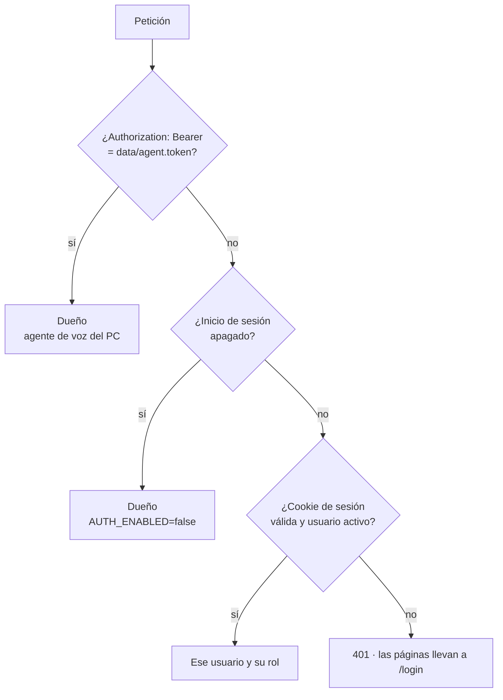

# Bitácora · Etapa 11: Seguridad y acceso desde la red local

**Fecha:** 2026‑10‑27 · **Rama:** `etapa/11-seguridad-red-local` · **Tecnología:** Argon2 (argon2-cffi) · JWT (PyJWT) · Caddy (`tls internal`) · Firewall de Windows

## Objetivo
Entrar a JARVIS desde el celular y los demás equipos de la casa, con usuario y contraseña, por HTTPS (para que el navegador del celular permita el micrófono).

**Terminado cuando:** desde el celular entra con usuario y contraseña a `https://<ip-del-pc>` y le habla por el micrófono del celular. ⏳ *Falta que el dueño ejecute `scripts\red_local.ps1` (cambia la configuración de Windows) y lo pruebe desde su celular.*

## Qué se construyó

```
app/services/auth_service.py      # Argon2, sesiones firmadas, límite de intentos, usuarios
app/controllers/auth_controller.py   # /api/auth/{login,logout,me,setup} · /api/users
app/core/dependencies.py          # quién hace cada petición y qué rol necesita
app/core/keys.py                  # data/secret.key y data/agent.token (se crean solos)
app/views/templates/login.html · users.html   (+ js/login.js · js/users.js)
deploy/caddy/Caddyfile            # HTTPS en la red de la casa
scripts/red_local.ps1             # lo ejecuta el dueño como administrador
scripts/jarvis.ps1                # ahora también enciende y apaga Caddy (-SinRed para no)
tests/test_auth.py
```

Las tablas ya estaban listas desde la Etapa 2 (`users.password_hash`, `users.role`): no hizo falta migración.

## Quién es quién en cada petición



| Rol | Chat | Su memoria | Documentos | Calificar | Ajustes de voz | Usuarios |
|---|---|---|---|---|---|---|
| **Dueño** (`owner`) | ✅ | ✅ | ✅ | ✅ | ✅ | ✅ |
| **Familia** (`member`) | ✅ | ✅ | ✅ (personales: sólo los suyos) | ✅ | ✅ | ❌ |
| **Invitado** (`guest`) | ✅ | ❌ (no aprende de él) | ❌ | ❌ | ❌ | ❌ |

## Decisiones

| Decisión | Por qué |
|---|---|
| **Argon2id** para contraseñas | Lento a propósito y usa memoria: adivinar por fuerza bruta es caro. Se vuelve a cifrar solo si cambian los parámetros recomendados |
| **Sesión en cookie firmada (JWT HS256)**, no en la base de datos | Sin tabla de sesiones; la clave vive en `data/secret.key` (nunca en Git). El usuario se vuelve a leer en cada petición: si se desactiva, sale al instante aunque la cookie siga vigente |
| Cookie `HttpOnly` + `SameSite=Lax` + `Secure` tras HTTPS | El JavaScript no la lee; otros sitios no la usan; sólo viaja cifrada |
| **5 intentos fallidos → 5 min de bloqueo** por usuario | Frena a quien pruebe contraseñas desde la red |
| Mismo tiempo de respuesta exista o no el usuario | No revela qué nombres de usuario existen |
| **Token propio para el agente de voz** | El agente corre en el mismo PC sin navegador; entra como el dueño con `data/agent.token` |
| **Primera vez: el dueño elige su contraseña en la pantalla de entrada** | Nadie (ni JARVIS) la conoce antes. Sólo funciona una vez |
| **La API sigue en `127.0.0.1`** y Caddy va delante | Desde la red sólo se entra por HTTPS; nada habla directo con la API |
| **Caddy con `tls internal`** y `default_sni` | Certificados de una autoridad local (sin internet). Por IP los navegadores no envían el nombre del sitio, por eso `default_sni` |
| `http://<ip>/certificado` público | El certificado raíz no es secreto (la clave privada nunca sale de `%APPDATA%\Caddy`); el celular lo necesita antes de poder confiar en HTTPS |
| **Firewall y certificado los ejecuta el dueño** (`red_local.ps1`) | Son cambios de seguridad de Windows: el script pregunta antes de cada paso y se deshace con `-Quitar` |
| Invitados: sin memoria | Son visitas: JARVIS no guarda nada de lo que dicen |

## Pruebas (`tests/test_auth.py`)
- Argon2 no guarda la contraseña en claro; el dueño sin contraseña (`!`) no puede entrar.
- La sesión no se puede falsificar (otra clave, token alterado) y vence.
- Sin sesión: las páginas llevan a `/login?next=…` y la API responde 401.
- La contraseña del dueño se elige una sola vez.
- 5 intentos fallidos bloquean, incluso con la contraseña correcta; `Retry-After`.
- Dueño, familia e invitado: cada uno sólo llega a lo suyo; **el invitado no ve recuerdos ni documentos, y JARVIS no aprende de él**.
- Desactivar a alguien lo saca aunque tenga la cookie.
- El agente de voz entra con su token; con otro token, no.
- Usuarios inválidos: repetidos, con espacios, contraseña corta.

El resto de las pruebas corre con `AUTH_ENABLED=false` (como el dueño), igual que antes.

## Verificado en el PC
- Sin sesión, `http://localhost:8000` lleva a la pantalla de entrada, que pide elegir la contraseña del dueño.
- `GET /api/conversations` sin sesión → **401**.
- El agente de voz sigue respondiendo con su token (`--simular`).

## Problemas encontrados

| Problema | Causa | Solución |
|---|---|---|
| El vencimiento de la sesión no se podía probar | PyJWT revisa `exp` con el reloj del sistema | Se revisa con el reloj del servicio (inyectable en las pruebas) |
| Las pruebas viejas fallaban sin `role` | Simulaban al usuario sólo con `id` | `as_owner(app)` en `tests/fakes.py` |
| `app/core/secrets.py` se confundía con el módulo `secrets` de Python | Mismo nombre | Se llama `keys.py` |

## Límites conocidos
- **Fuera de casa no funciona** a propósito. Para eso: VPN (WireGuard / Tailscale), nunca abrir puertos del router.
- **Si cambia la IP del PC** hay que reservarla en el router (guía en [docs/02](../02-acceso-desde-la-red-local.md#6-ip-fija-recomendado)).
- **Sin "olvidé mi contraseña"**: el dueño la cambia desde *Usuarios*. Si el dueño olvida la suya: borrar `password_hash` del dueño en la base (vuelve a pedirla al abrir).
- El límite de intentos vive en memoria: se reinicia al reiniciar la API.

## Siguiente etapa
**Etapa 12:** ajuste fino con LoRA usando las correcciones (👎) guardadas desde la Etapa 10.
