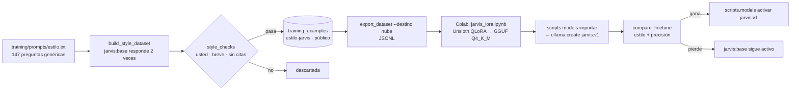

# Bitácora · Etapa 12: Ajuste fino con LoRA

**Fecha:** 2026‑10‑27 · **Rama:** `etapa/12-lora` · **Tecnología:** Unsloth (QLoRA) en Google Colab · GGUF Q4_K_M · `ollama create`

## Objetivo
Ajustar el **estilo** de JARVIS (de usted, breve, honesto con lo que no puede hacer) dentro del propio modelo, sin perder precisión. **El conocimiento sigue viviendo en el RAG** (Etapa 5) y lo personal en la memoria (Etapa 10).

**Terminado cuando:** existe `jarvis:v1` en Ollama, supera al modelo base en estilo y no empeora la precisión. ⏳ *Todo está listo en el PC; falta entrenar en Colab (necesita la cuenta de Google del dueño) y comparar.*

## Por qué en Colab y no en este PC

| | Este PC (GTX 1650 Ti) | Colab gratis (T4) |
|---|---|---|
| Memoria de video | 4 GB | 15 GB |
| QLoRA de Qwen3-4B | ❌ no cabe (necesita ~7–8 GB) | ✅ ~20–30 min |
| Datos personales | ✅ se quedan aquí | ❌ **nunca** se suben |

**Regla de privacidad:** a Colab sólo va el dataset de estilo, hecho con preguntas genéricas. Los datasets marcados como personales (las correcciones 👎 de la Etapa 10) **no se pueden exportar para la nube**: `export_dataset --destino nube` se niega. Entrenar con ellos en este PC exigiría un modelo de 1B–3B, mucho peor que el actual: por ahora lo personal se queda en la memoria y el RAG, que ya funcionan bien.

## El flujo completo



### Paso a paso (lo que hace el dueño)

```powershell
# 1. (ya hecho) generar el dataset de estilo: ~5 min
.venv\Scripts\python -m scripts.build_style_dataset
# 2. exportarlo para Colab
.venv\Scripts\python -m scripts.export_dataset estilo-jarvis --destino nube
#    → training\datasets\estilo-jarvis-nube.jsonl
```
3. Abrir [`training/notebooks/jarvis_lora.ipynb`](../../training/notebooks/jarvis_lora.ipynb) en [Google Colab](https://colab.research.google.com) (Archivo › Subir cuaderno), elegir **GPU T4** y ejecutar las celdas en orden. Al final se descarga `jarvis-v1.Q4_K_M.gguf` (~2,5 GB).
4. Guardarlo en `models\` (no va a Git) y:
```powershell
.venv\Scripts\python -m scripts.models importar models\jarvis-v1.Q4_K_M.gguf --tag jarvis:v1
.venv\Scripts\python -m scripts.compare_finetune --nuevo jarvis:v1
.venv\Scripts\python -m scripts.models activar jarvis:v1     # sólo si ganó
.venv\Scripts\python -m scripts.models volver                # deshace la activación
```

## Qué se construyó

```
app/services/style_checks.py       # ¿tiene el estilo de JARVIS? (compartido)
app/services/dataset_service.py    # guardar ejemplos y exportar JSONL (con la regla de privacidad)
app/services/model_manager.py      # importar GGUF, activar, volver atrás
app/core/dependencies.py           # el chat usa el modelo ACTIVO de la base (sin reiniciar)
training/prompts/estilo.txt        # 147 preguntas para entrenar
training/prompts/estilo_eval.txt   # 25 preguntas SÓLO para comparar (nunca se entrenan)
training/notebooks/jarvis_lora.ipynb
scripts/build_style_dataset.py · export_dataset.py · models.py · compare_finetune.py
tests/test_training.py
```

## Decisiones

| Decisión | Por qué |
|---|---|
| **El "profesor" es `jarvis:base`** y sólo se guardan sus mejores respuestas | Ya tiene la personalidad (SYSTEM del Modelfile). Filtrar lo malo (tuteo, citas inventadas, listas, emojis) deja un dataset más consistente que el propio modelo: el ajuste empuja hacia sus mejores respuestas |
| **2 respuestas por pregunta** (temperatura 0,7) | Más variedad con las mismas preguntas |
| **Preguntas de evaluación separadas** y una prueba que lo comprueba | Comparar con preguntas entrenadas sería hacer trampa |
| **Se entrena con el mismo SYSTEM** del Modelfile | El modelo ajustado se usa con esa personalidad: entrenar con ella evita sorpresas |
| **QLoRA r=16, 2 épocas, lr 1e-4, sólo las respuestas** (`train_on_responses_only`) | Ajusta el estilo sin "olvidar" lo que el modelo sabe; no aprende a repetir el SYSTEM ni las preguntas |
| **GGUF Q4_K_M** | El mismo tamaño que `jarvis:base`: cabe 100 % en la GPU (Etapa 3) |
| **El Modelfile de `jarvis:v1` se genera** a partir del de `jarvis:base` | Misma personalidad, parámetros y ejemplos; sólo cambian los pesos |
| **La plantilla de chat se copia de `ollama show --modelfile`** | La API `/api/show` la entrega en Jinja y un Modelfile la necesita en formato Go (falló la primera vez) |
| **El modelo activo vive en `model_versions`** y se lee en cada pregunta | Activar o volver atrás se nota de inmediato, sin reiniciar. `scripts/seed.py` ya no pisa la versión activa |
| Gana sólo si **mejora el estilo y no pierde precisión** | El RAG (Etapa 5) es lo que hace a JARVIS acertado: un estilo bonito con datos errados no sirve |

## Verificado en el PC
- **Dataset de estilo:** 147 preguntas × 2 respuestas → **272 guardadas, 13 descartadas** (8 tuteaban, 2 vacías, 3 con listas largas, demasiado largas o emojis). ~1,9 s por pregunta.
- **Exportación:** `estilo-jarvis-nube.jsonl` con 272 ejemplos; la carpeta `training/datasets/` no va a Git.
- **Importar → activar → volver**, de verdad con Ollama: se importó el GGUF de `qwen3:4b-instruct` como `jarvis:prueba` (mismos pesos, para probar el flujo sin esperar a Colab), se activó y el chat lo usó sin reiniciar; `volver` regresó a `jarvis:base`.
- **`compare_finetune` de punta a punta** (`--rapido`, `jarvis:base` contra `jarvis:prueba`, mismos pesos): estilo 10/10 contra 10/10, precisión 8/10 contra 8/10 → *"El nuevo no cumple"*, como debe ser cuando no mejora.
- El cuaderno: sus celdas de código son Python válido. **No se ejecutó en Colab** (necesita la cuenta de Google del dueño).

## Problemas encontrados

| Problema | Causa | Solución |
|---|---|---|
| `template error: malformed character constant` al importar | La API `/api/show` da la plantilla en Jinja; el Modelfile la quiere en Go | Se copia de `ollama show --modelfile` (formato Go) junto con las marcas `stop` |
| Ruff revisaba y reformateaba el cuaderno | Ruff también lee `.ipynb` | `extend-exclude = ["training/notebooks"]` |
| `scripts/seed.py` volvía a activar `jarvis:base` | Activaba el modelo del `.env` cada vez | Sólo lo activa si no hay ninguno activo |

## Límites conocidos
- **Entrenar requiere Colab** (cuenta de Google) o una GPU de ≥ 8 GB.
- **Lo personal no se entrena** en este PC con un modelo de 4B; sigue en la memoria (Etapa 10) y los documentos (Etapa 6).
- El dataset es pequeño (~300 ejemplos): suficiente para el estilo, no para enseñar conocimiento nuevo (para eso está el RAG).

## Siguiente etapa
**Etapa 13:** herramientas (hora, recordatorios que avisan, control de dispositivos) y versión 1.0.
