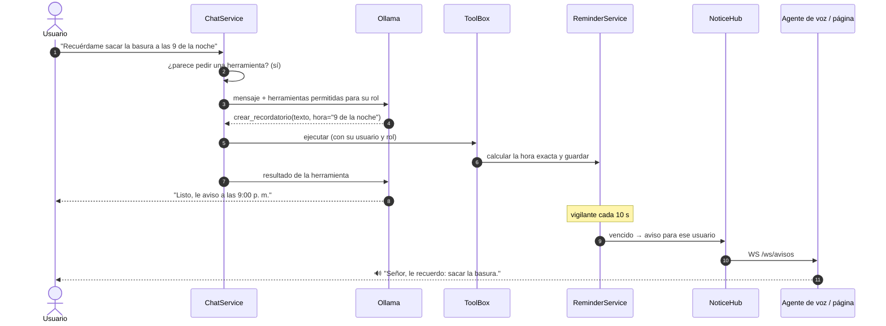

# Bitácora · Etapa 13: Herramientas, evaluación final y versión 1.0

**Fecha:** 2026‑10‑27 · **Rama:** `etapa/13-herramientas` · **Tecnología:** *tool calling* de Ollama · psutil · `pg_dump`

## Objetivo
Que JARVIS **haga cosas** y no sólo responda, que se respalde solo y que funcione completo **sin internet**.

**Terminado cuando:** todas las pruebas pasan y JARVIS funciona completo sin conexión a internet. ✅ **281 pruebas** · **9/9 funciones sin internet, 0 intentos de salir**.

## Qué puede hacer ahora

| Le dice… | Herramienta | Qué pasa |
|---|---|---|
| "Recuérdame sacar la basura a las 9 de la noche" | `crear_recordatorio` | A esa hora lo **dice en voz alta** por los parlantes del PC y aparece en la pantalla de quien lo pidió |
| "Avísame en 10 minutos que apague la estufa" | `crear_recordatorio` | Igual, dentro de 10 minutos |
| "¿Qué recordatorios tengo?" | `listar_recordatorios` | Los pendientes, con "hoy a las…" / "mañana a las…" |
| "Cancela el recordatorio de la basura" | `borrar_recordatorio` | Busca el más parecido y lo borra |
| "¿Cómo está el computador?" | `estado_del_sistema` | Procesador, RAM, disco y tarjeta gráfica (uso y temperatura) |
| "Busca en mis archivos el contrato" | `buscar_en_mis_archivos` | Busca en los documentos de la casa y en los suyos (no en los de otros) |
| "¿Qué hora es?" | (la hora va en el mensaje) o `fecha_y_hora` | Reloj del PC |

## Cómo funciona

## Decisiones

| Decisión | Por qué |
|---|---|
| **El modelo no calcula horas** | En la prueba, "en 10 minutos" a las 7:40 p. m. le dio **20:40**. Ahora sólo entrega piezas (`en_minutos: 10`, `hora: "9 pm"`, `fecha: "mañana"`) y `ReminderService` calcula la fecha exacta. Si la hora ya pasó hoy, es mañana |
| **Herramientas sólo cuando la frase las pide** ("recuérdame", "avísame", "estado del computador", "busca en mis archivos"…) | Ofrecerlas obliga a un paso extra sin *streaming*. Las preguntas normales siguen igual de rápidas y la voz empieza a sonar antes |
| **Cada herramienta declara sus roles** | Un invitado sólo puede pedir la hora; no crea recordatorios ni busca archivos |
| **Avisos por usuario** (`NoticeHub`, `WS /ws/avisos`) | Cada uno recibe sólo sus recordatorios. Si nadie está conectado, se guardan hasta que se conecte |
| **Si JARVIS estaba apagado**, avisa al encender: *"tenía pendiente un recordatorio de las…"* | Los recordatorios viven en la base, no en memoria |
| **El agente de voz dice los avisos** y la página los muestra (y los dice si el agente está apagado o en el celular) | En el PC no suenan dos veces |
| **Sin aprender de lo que usó herramientas** | "Recuérdame sacar la basura" ya es un recordatorio; como recuerdo quedaría viejo al día siguiente |
| **Copias de seguridad desde la propia API** (cada hora revisa; si la última tiene más de 24 h, hace una) | Sin tocar el Programador de tareas de Windows |

## Verificado

**Herramientas en vivo** (por la API, con el modelo real):

| Frase | Herramienta | Tiempo |
|---|---|---|
| "Recuérdame probar el aviso en 1 minuto" | `crear_recordatorio` ✅ | 9,7 s |
| "Recuérdame sacar la basura a las 9 de la noche" (eran las 9:05 p. m.) | `crear_recordatorio` → mañana ✅ | 12,8 s |
| "¿Qué recordatorios tengo?" | `listar_recordatorios` ✅ | 17,3 s |
| "¿Cómo está el computador?" | `estado_del_sistema` ✅ | 11,6 s |
| "¿Cuál es la capital de Canadá?" | ninguna (correcto) ✅ | 8,5 s |
| "Cancela el recordatorio de la basura" | `borrar_recordatorio` ✅ | 4,5 s |

Al minuto, el vigilante entregó el recordatorio al agente de voz, que dijo **"Señor, le recuerdo: probar el aviso."**

**Copias de seguridad:** se hizo una copia real (3,3 MB) y **se restauró** en una base temporal: 675 fragmentos, 1 recuerdo, 1 usuario y 408 mensajes, idénticos a la original.

**Sin internet:** se arrancó una copia de la API (puerto 8001) y el agente de voz con una "guardia" (`sitecustomize.py`) que **bloquea y anota** cualquier conexión fuera del PC. Antes se comprobó que la guardia funciona (bloqueó `huggingface.co`).

| Función | Resultado |
|---|---|
| API, Ollama y base de datos | ✅ |
| Conversar | ✅ |
| Documentos (bge-m3 + pgvector) | ✅ "puerto 5434 [1]" |
| Recordatorio | ✅ |
| Estado del PC | ✅ |
| Voz a texto (Whisper, sin descargar nada) | ✅ "Jarvis, ¿cómo estás?" |
| Texto a voz (Piper) | ✅ |
| Memoria | ✅ |
| Agente de voz completo ("Hola Jarvis, ¿qué hora es?") | ✅ |
| **Intentos de salir a internet** | **0** |

(La ingesta de páginas web y Wikipedia, Etapa 6, sí usa internet por diseño; se apaga con `INGESTION_ALLOW_INTERNET=false`.)

## Pruebas
`tests/test_tools.py` (33): horas como las dice la gente, "en 10 minutos" bien calculado, horas imposibles, cuándo ofrecer herramientas, avisos aislados por usuario y guardados si nadie está conectado, crear/listar/cancelar/avisar una sola vez, aviso tarde, un invitado no puede crear recordatorios, el chat usa la herramienta y la dice con sus palabras, sin pedido no se ofrecen, estado del PC, copias diarias y limpieza. **281 pruebas en total, sin avisos.**

## Problemas encontrados

| Problema | Causa | Solución |
|---|---|---|
| "En 10 minutos" → 20:40 | El modelo de 4B no hace bien cuentas de horas | El modelo entrega piezas; la hora la calcula `ReminderService` |
| 21 avisos de PyJWT en las pruebas | Claves de prueba cortas | Claves de 40+ caracteres y `AuthService` rechaza claves de menos de 32 (la real tiene 43) |
| `SyntaxWarning: invalid escape sequence '\s'` | Una barra se perdió en el mensaje de `/certificado` | Corregido |
| La copia de prueba no se restauraba | Git Bash cambia las rutas `/tmp/…` dentro de `docker exec` | `MSYS_NO_PATHCONV=1` al probar (el servicio usa `subprocess`, sin ese problema) |

## Límites conocidos
- **Con herramientas tarda más** (5–17 s): el modelo decide sin *streaming* y luego responde. Las preguntas normales no cambian.
- **Recordatorios únicos:** todavía no hay "todos los lunes".
- **No controla dispositivos** (luces, TV): necesitaría Home Assistant u otro integrador local.
- El aviso en el celular sólo llega con la página abierta (no hay notificaciones push sin servicios externos).

## Versión 1.0
Pendiente del dueño: revisar y fusionar los PR #10 a #13, grabar capturas o un video corto, y entonces etiquetar `v1.0.0` y publicar el *release* en GitHub.
